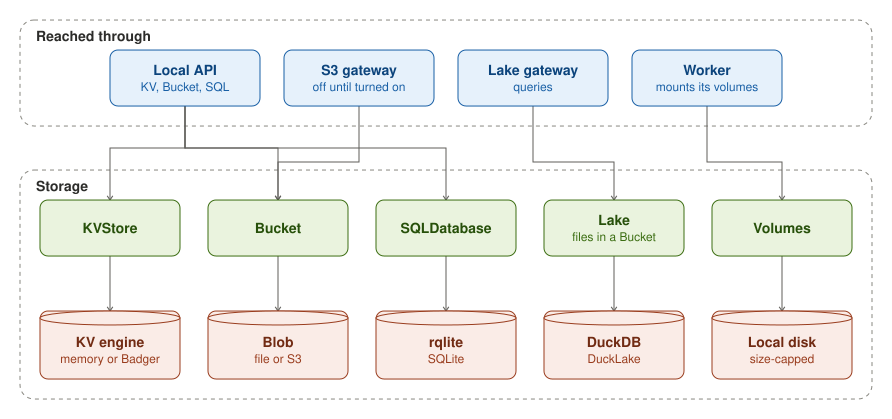

funcd serves the stores a Function binds: a KVStore, a Bucket, a SQLDatabase and a Lake, and the Function's own
volumes. A Function reaches KV, its Buckets and its SQL databases through its local API. S3 clients, including a
Function, reach a Bucket through funcd's S3 gateway. A Lake answers queries through its Lake gateway. The worker mounts
its volumes.

Each store runs on an engine. KV runs on Badger. A Bucket keeps its objects in files or in S3, and serves the S3
protocol through funcd's S3 gateway. A SQL database runs on rqlite, which keeps its data in SQLite. A Lake runs on
DuckDB with DuckLake, and keeps its files under a prefix of a Bucket. A volume is a directory of a fixed size on the
local disk.

Each service has its own page: [KV](kv.md), [Bucket](bucket.md), [SQL](sql.md) and [Lake](lake.md).

## On disk

funcd keeps its stores under one directory, `storage.dataDir`:

<Files>
  <Folder name="<dataDir>" defaultOpen>
    <Folder name="store — the metastore" disabled />
    <Folder name="eventstore — the event store" disabled />
    <Folder name="workflow — the Workflow run state" disabled />
    <Folder name="kv — KV's own Badger" disabled />
    <Folder name="blob — Buckets as files, unless S3" disabled />
    <Folder name="providers — the SQL and Lake engines' data" disabled />
    <Folder name="nats — the internal bus" disabled />
    <Folder name="artifacts — Function bundles" disabled />
  </Folder>
</Files>
