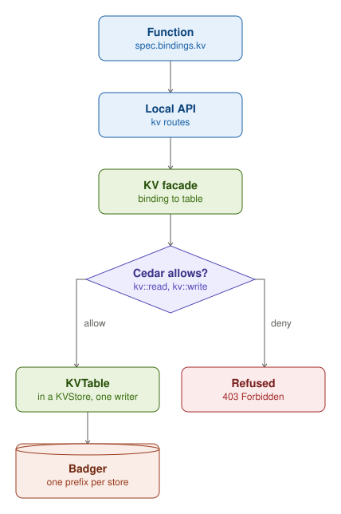

A KVStore holds named tables, and each table has one writer, its owner. A Function reaches a table only through a
binding in `spec.bindings.kv`. Its calls go to its local API, and the KV facade enforces the check: it turns the
binding into a table, then asks Cedar whether this Function may `kv::read` it (a get or a list) or `kv::write` it (a
put or a delete). Cedar decides from its rules: a bound table is readable, only its owner and the writers a
RolesAssignment names can write it, and the namespace's Policies can permit or forbid more. When Cedar allows, the
facade runs the call on the table's key prefix; when it denies, the Function gets 403 Forbidden.

Each key has a version. A write can be conditional: it creates a key only if the key is absent, or replaces or deletes
it only while it still has the version the caller read, and otherwise it is refused (412). A key can also expire after
a time to live. All KVStores share one Badger instance, apart from the metastore's, with one key prefix per store.
