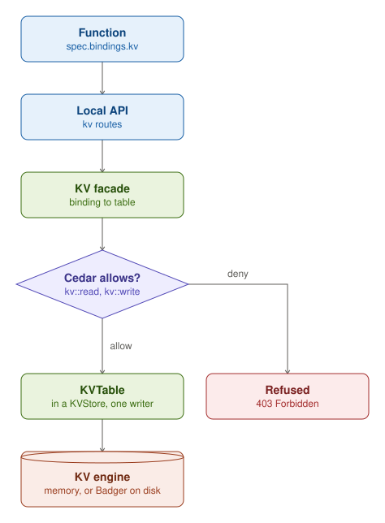

A KVStore holds named tables, and each table has one writer, its owner. A Function reaches a table only through a
binding in `spec.bindings.kv`. Its calls go to its local API, where the KV facade enforces the check. The facade turns
the binding into a table, then asks Cedar whether this Function may `kv::read` it (a get or a list) or `kv::write` it
(a put or a delete). Cedar decides from its rules: a bound table is readable, only its owner and the writers that a
RolesAssignment names can write it, and the namespace's Policies can permit or forbid more. When Cedar allows the
call, the facade runs it on the table's key prefix. When Cedar denies it, the Function gets 403 Forbidden.

Each key has a version. A write can be conditional. It creates a key only if the key is absent, or it replaces or
deletes the key only while the key still has the version that the caller read. Otherwise, KV refuses the write with
412. A key can also expire after a time to live.

KV runs on one of two engines. By default, funcd keeps KV in memory: a restart loses every key, while the KVStores stay
Ready. With the durable engine, which the operator chooses in funcd's configuration, funcd keeps KV on disk in Badger.
All KVStores then share one Badger instance, apart from the metastore's, with one key prefix for each store. KV backups
need the durable engine.
