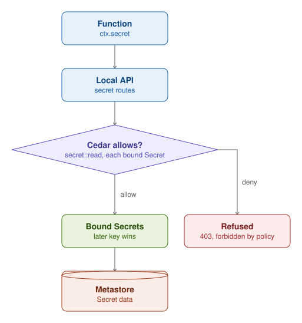
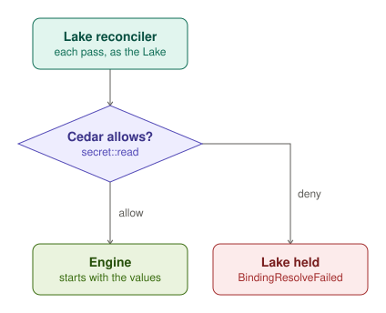

A Secret holds named values, its `spec.data`, in a namespace. A Function names the Secrets that it reads in
`spec.bindings.secret`, and a Workflow step and a Lake bind Secrets the same way. A Function reads the values with
`ctx.secret.get` and `ctx.secret.list` through its local API, so they never reach the worker's environment. Each read
asks funcd, with no cache: a changed Secret shows at the next read, without a restart. A read resolves every Secret
that the Function binds, and when two of them hold the same key, the later Secret's value wins.

Each read asks Cedar whether the Function may `secret::read` each Secret that it binds. The built-in policy
`secret-read-binding` allows a bound Secret, and no built-in role grants `secret::read`. A namespace Policy can forbid
a Secret. Each of the Function's next reads then fails with 403, even for a key that another Secret holds, and its
workers stop being ready within `runtime.supervisionPeriod` (10 s by default). With no ready worker, the Function is
`Degraded` and its calls wait. Once the forbid goes, the next check makes the workers ready again.

funcd stores Secrets in the metastore. It encrypts them at rest when `secrets.encryptionKeyFile` names a key file.
Without one, it stores them unencrypted and logs a warning at startup. People read and write Secrets through the API,
where RBAC decides, as for every other kind.

## A Lake's Secrets

A Lake's engine reads its Secrets, such as its `QUACK_TOKEN`, from its environment when it starts. The Lake
reconciler therefore asks Cedar, as the Lake, whether it may `secret::read` each Secret that the Lake binds, and it
asks again on each of its passes. A forbid holds the Lake in `Pending` with the reason `BindingResolveFailed`, and it
stops an engine that runs. funcd asks again every `controller.referentPollInterval` (2 s by default), and once the
forbid goes, the engine starts with the values.
