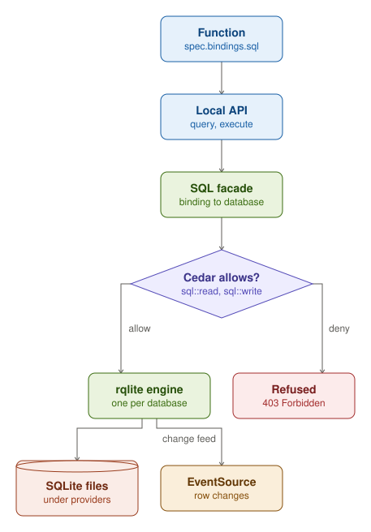

A SQLDatabase is a SQL database with its own rqlite engine. funcd runs one engine per database through its add-on
runtime, as a container on a funcd server and as a host process under `funcdctl dev`, and keeps its data, SQLite
files, under `<dataDir>/providers`.

A Function reaches a database through a binding in `spec.bindings.sql`: its local API takes `query` and `execute`
calls, and the SQL facade asks Cedar for `sql::read` or `sql::write` before it passes them to the engine. The engine
also posts each row change to funcd, which an EventSource of the `sql` kind turns into events.
