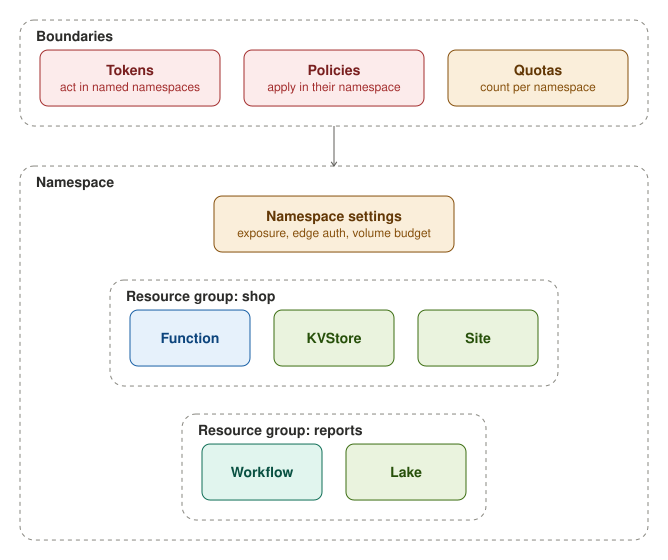

Every resource of a workload or a service lives in a namespace and names a resource group within it. The namespace is
the unit of tenancy, and the resource group is the unit that its resources are managed in.

## Namespaces

A namespace sets the boundaries of what is inside it. A token acts only in the namespaces that it names, and a Policy
applies only in its own namespace: a request into another namespace meets only funcd's built-in policies. Quotas count
the stores of each namespace, and a namespace has a budget for the volumes of its Functions.

A namespace exists as soon as a resource names it. A Namespace resource is optional and holds only the namespace's
settings: how its Functions, Sites and Lakes are exposed by default, the default authentication on the edge, and the
volume budget. Nothing reconciles it, so it has no phase. Deleting it removes the settings alone: everything in the
namespace keeps running, and new resources can still be created there. Only an administrator can delete one.

## Resource groups

A resource group gathers the resources of a namespace that belong together, such as the parts of one application. Every
resource names one, and a group, like a namespace, exists as soon as a resource names it. funcd refuses to delete a
group while resources that no other resource owns still name it, and lists the first of them. An App's parts, for
example, go with their App and never block a delete. A forced delete removes the members first, Sensors first, each
under its own permissions and checks, and then the group. A member that is still refused stops the delete, with no
rollback, and running it again continues where it stopped.
