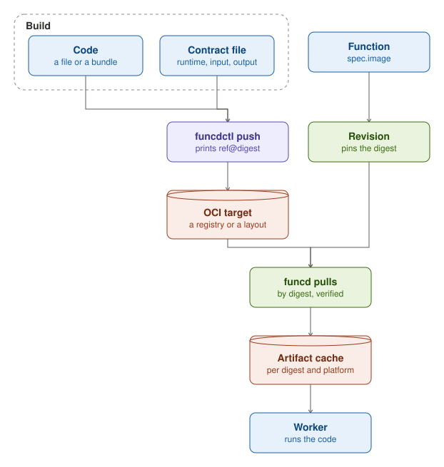

A Function's code reaches funcd as an OCI artifact, the kind of package that container registries hold. The
artifact carries the code, a single file or a bundle, together with its contract and the runtime that runs it. It
lives in any OCI registry or in an OCI layout on disk, and the digest of its content identifies it.

A Function names its artifact by a reference, with a tag or a digest. When the Function changes, funcd creates a
Revision and pins in it the digest that the tag names at that moment. What was validated is what runs: a tag that
moves later changes nothing until the Function changes again, and no one can edit a Revision.

funcd pulls the artifact by its pinned digest, checks the content against that digest, and keeps the code in a
local cache, so a worker that starts again does not pull it again. The contract travels inside the artifact, so funcd
and its tools read what a Function accepts and returns without pulling or running its code. When funcd cannot
resolve the reference, or when the artifact holds no valid contract, the Function does not start.

## Several platforms

An artifact can hold one build for each platform, such as Linux on amd64 and Linux on arm64, under one reference.
funcd pulls the build for its own node's platform. A Function whose artifact has no build for that platform does not
start.

## Registries

funcd pulls from public and private registries. For a private registry, it uses the credentials stored for the user
that runs it. An OCI layout on the server's disk needs no registry and no credentials.

## Sites and App templates

A Site's static files and an App's template travel as OCI artifacts too. A [Site](site.md)'s bundle is resolved to a
digest when the Site changes, as a Function's code is. An [App](app.md) template names its images by their digests, so
every rendering of the App deploys the same code.
