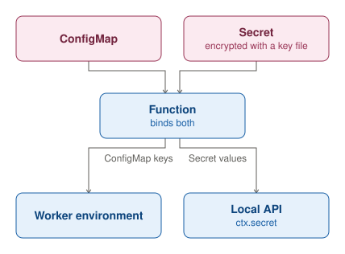

A Function binds ConfigMaps and Secrets. The keys of a bound ConfigMap reach its workers as environment variables. A
Secret's values never reach a worker's environment: the Function reads them with `ctx.secret`, through its local API.
funcd encrypts Secrets at rest when it has a key file (`secrets.encryptionKeyFile`). Without a key file, it stores
them unencrypted and logs a warning at startup.
