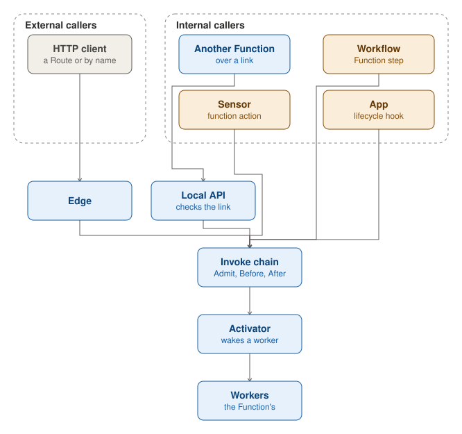
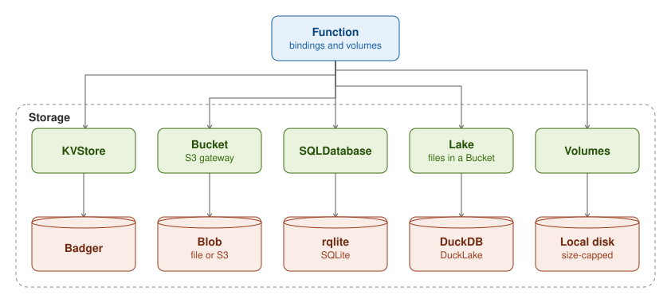

## Callers

A Function is called from outside funcd or from inside it. From outside, an HTTP client reaches it through the edge,
on one of its Routes or at `/function/<name>`. From inside, another Function calls it through its local API, over a
link that the caller declares in `spec.bindings.links`. A Sensor calls it in a function action, a Workflow runs it as
a Function step, and an App calls it at a lifecycle hook.

Every call, whoever makes it, goes through the invoke chain. Admit runs before funcd reads anything about the
Function. Before runs before the worker is called or started. After runs on the answer, before the caller sees it.
When the Function has no worker running, the activator starts one and holds the call until the worker is ready.

## Bindings

A Function names what it uses in `spec.bindings`: KVStores, Buckets, SQL databases and Lakes, and also other Functions
(`links`), ConfigMaps and Secrets. Its volumes come from `spec.volumes`.

Each store runs on an engine. KV runs in memory by default, or on Badger when the operator chooses the durable engine. A
Bucket keeps its objects in files or in S3. A SQL database runs on rqlite, which keeps its data in SQLite. A Lake runs
on DuckDB with DuckLake, and keeps its files under a prefix of a Bucket. A volume is a directory of a fixed size on the
local disk.
