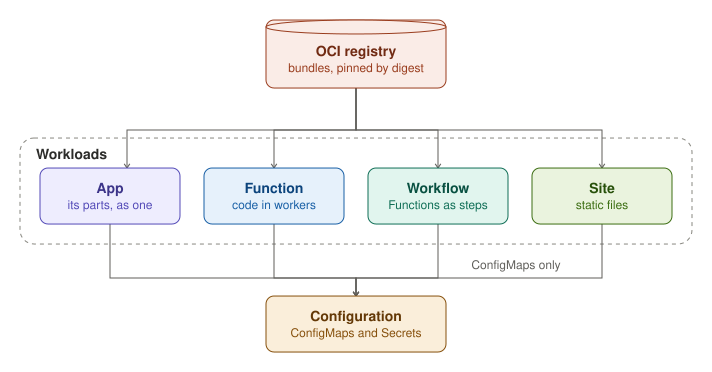

A Function is the code that funcd runs. Each change to it creates an immutable Revision, and workers run that
Revision. A Function runs in workers of its own, or in a pool that it shares with other Functions.

An App declares a whole app in one resource: its Functions, Workflows, Sites, Routes, stores, EventSources, Sensors
and ConfigMaps. The App creates an AppRevision for each changed spec, so that it can roll back.

A Site is a static web app. Its bundle is stored under a prefix of a Bucket, and its Route serves it.
