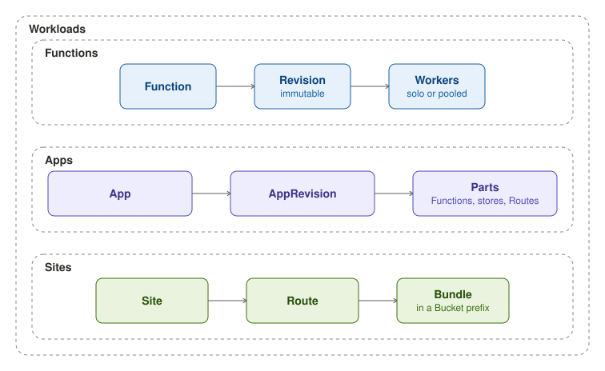

A Function is your code. Each change to it stamps an immutable Revision, and workers run that Revision, each Function
in workers of its own or in a pool shared with other Functions.

An App declares a whole app in one resource: its Functions, Workflows, Sites, Routes, stores, EventSources, Sensors
and ConfigMaps. The App stamps an AppRevision for each changed spec, so it can roll back.

A Site is a static web app. Its bundle sits under a prefix of a Bucket, and its Route serves it.
