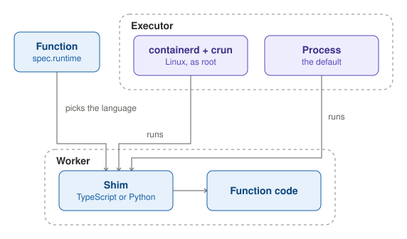

A Function names its language in `spec.runtime`, such as `nodejs22` or `python312`. Its code runs in a worker, where a
shim, in TypeScript or in Python, loads it and hands it its context.

The Executor runs the workers with a runtime driver. On a funcd server, the containerd driver runs each worker as a
container with runc. `funcdctl dev` uses the process driver, which runs workers as plain processes, without isolation.
