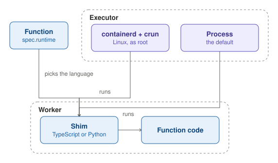

A Function names its language in `spec.runtime`, such as `nodejs22` or `python314`. Its code runs in a worker, where a
shim, in TypeScript or in Python, loads the code and gives it its context.

The Executor runs the workers with the runtime driver that `runtime.mode` names. The default, `process`, runs each
worker as a plain host process, without isolation, enforced limits or volumes. `funcdctl dev` also uses it. On Linux,
as root, `containerd` runs each worker in its own container with crun, on its own network.
