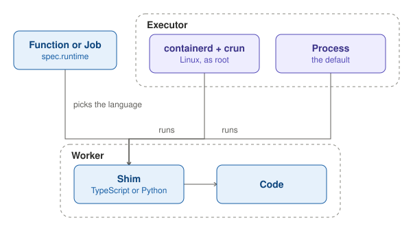

A Function or a Job names its language in `spec.runtime`, such as `nodejs22` or `python314`. Its code runs in a worker,
where a shim, in TypeScript or in Python, loads the code and gives it its context. `spec.runtime` can also name a
runtime that an [add-on](../services/addons.md) ships, and the worker then runs the add-on's image.

The Executor runs the workers with the runtime driver that `runtime.mode` names. The default, `process`, runs each
worker as a plain host process, without isolation or enforced limits, and a server in that mode refuses a Function
with volumes. `funcdctl dev` also uses it, but keeps each volume of a Function as a plain folder. On Linux, as root,
`containerd` runs each worker in its own container with crun, on its own network.
