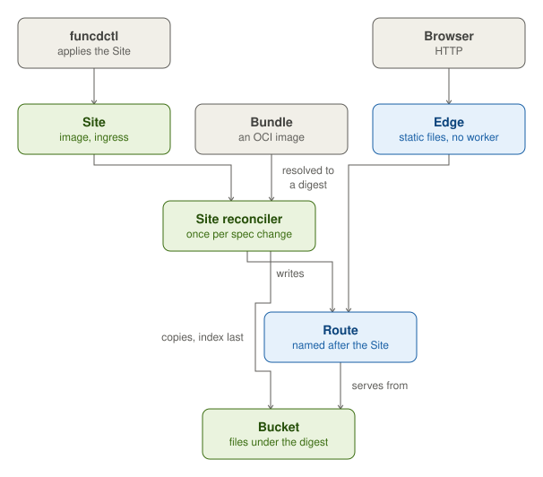

A Site serves a static web app. Its spec names the bundle, which is an OCI image, and the Route that the Site owns.
The Site reconciler resolves the image to a digest once for each change of the spec. It copies the bundle into the
Site's Bucket, under a prefix for that digest, and writes the index last, so that the index's presence means that the
copy is complete. It then writes the Site's Route.

The edge serves the files directly from the Bucket, with no worker: it resolves the index, sets the content types and
answers conditional requests. When a deploy fails, the previous digest keeps serving. The Site's status comes from its
Route. With `spa`, an unmatched path serves the index, so that a client-side router handles the routing.
`runtimeConfig` adds a generated `config.json` beside the bundle, so that each deployment sets its own values without
a rebuild.
