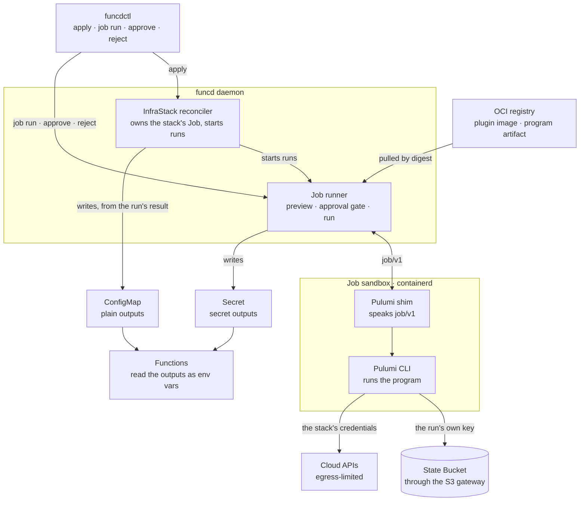
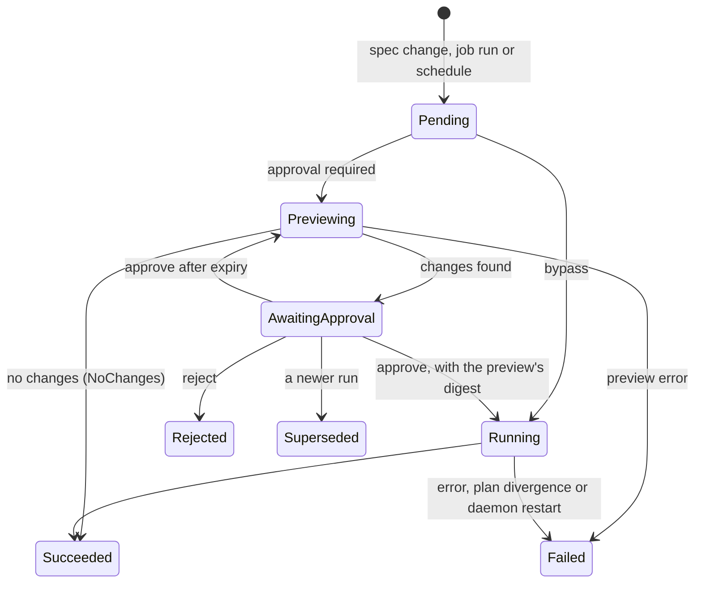

# InfraStack design: Pulumi stacks as funcd resources

- **Date**: 2026-10-14
- **Deciders**: green-0-rabbit
- **Status**: draft design. One decision is refined with the decider (2026-10-14): the `Job` kind is generic from v1.
  No feat doc, ADR or roadmap item exists yet, and every new name is a placeholder. Code references point at commit
  `c448b515`; the Pulumi facts were checked on Pulumi's documentation on 2026-10-14.

## Summary

funcd keeps cloud infrastructure applied the way Crossplane does on Kubernetes, but the unit is a whole program rather
than one cloud resource. An `InfraStack` resource runs an existing Pulumi program, written in YAML or TypeScript, on a
runtime plugin. Each change is previewed and waits for a person's approval unless the stack says `bypass`, and the run
applies exactly what was previewed. The stack's outputs reach Functions through a ConfigMap and a Secret.

| Topic | Decision |
|---|---|
| Kind | `InfraStack`, with an `engine` field. Pulumi comes first; OpenTofu later is another plugin on the same kind |
| Engine delivery | A runtime plugin: an OCI image that an admin registers, pulled from the registry the admin chose, never embedded in the funcd binary |
| Long work | A generic `Job` kind (a definition with default params) and `JobRun` (one execution), as `Workflow` and `WorkflowRun` are. Generic from v1, though Pulumi is its first runtime |
| Programs | Pulumi YAML or TypeScript, unchanged, packed into an OCI artifact with their provider plugins |
| Approval | `approval.mode` is `required` (the default) or `bypass`, with an `expiry`. `funcdctl job run --approve` runs exactly what was previewed |
| Governance | Six `job::*` Cedar actions decide who may run, override, approve, reject, cancel or set `bypass`, inside what RBAC allows. This needs a `User` principal, which funcd lacks today |
| Apps | An App counts a stack by what is applied, so an approval never holds an App's rollout |
| Outputs | Plain outputs go to a ConfigMap and secret outputs to a Secret; Functions read both as env vars |
| Crash | A run cut by a daemon restart ends `Failed` and is never restarted on its own |

| Crossplane | funcd |
|---|---|
| Provider + managed resources | `InfraStack` + a runtime plugin |
| Composition functions | The Pulumi program |
| XRD + Composition | App template + App, with a new `infra` section |
| Configuration package | OCI program artifact and App template |

## What this changes in the platform

The blueprint gives funcd's purpose as running functions and agents on one Linux machine, with low resource use among
its goals (`blueprint.md:23-33`). Its only IaC section (`blueprint.md:1034-1040`) covers the opposite direction: a
Terraform provider that manages funcd through its API. InfraStack makes funcd a control plane for infrastructure
outside the machine. That is a new purpose, so the work starts with a blueprint change and a feat doc, before any ADR.

It changes five Implemented decisions. Each change is a superseding ADR:

| Decision | Change |
|---|---|
| ADR-0177 Decision 1: a team's Policies apply only when the principal and the resource are in the Policy's namespace | A `User` has no namespace. For `job::*`, the request namespace becomes the resource's namespace when the User's RBAC scope includes it |
| ADR-0213: a missing Secret that an App declares stops the App's pass before any part is written | A Secret that a stack of the App produces counts as waiting for that stack |
| ADR-0214: a post-hook starts when it is due | A post-hook also waits for the stacks it needs (Apps, below) |
| ADR-0149: `ImageFor` is the single runtime→image mapping, and no reconciler reads `RuntimeClass` | `ImageFor` reads `RuntimeClass` first, so a plugin's image is still found through one mapping |
| The blueprint's purpose and its IaC section | They gain infrastructure outside the machine |

It also needs pieces that funcd lacks, listed under [Gaps in today's code](#gaps-in-todays-code): a principal for
people, Cedar checks on control-plane writes, a record of who wrote an object, and a kind that runs to completion.

## How funcd does these things today

| Need | What exists | Where |
|---|---|---|
| A sandbox that runs to completion | The runtime port creates, starts, stops and removes a worker and reports how it ended (`Exit` cause and code, ADR-0160), within memory and CPU `Limits`. No kind runs one to completion yet | `internal/runtime/runtime.go:47-71`, `:120-141` |
| An engine outside the daemon | The add-on provider runtime runs the rqlite and DuckDB engines and recreates a dead engine on every reconcile | `internal/provider/runtime.go:18-26` |
| Images | nodejs22, python314, duckdb and rqlite are embedded in the binary. Any other image is pulled only from a registry the operator chose (`runtime.containerd.imageOverride` or a custom `imagePrefix`), with no registry credentials | `internal/runtime/embedimg/embedimg.go:35-49`, `internal/runtime/containerd/containerd_linux.go:1124-1178`, ADR-0149 |
| Artifacts | An ORAS client pulls a funcd artifact by digest. An image index picks the node's platform. The I/O contract is its own blob, readable without pulling the bundle | `internal/artifact/artifact.go:1-60`, `internal/artifact/platform.go:48-55`, ADR-0031, ADR-0059, ADR-0145 |
| A run's input | WorkflowRun admission checks `spec.input` against `Workflow.status.contract`, and the engine checks it again at run start | `internal/controlplane/admission/workflowrun.go:89`, `internal/workflow/engine.go:304` |
| Merging defaults and input | Maps merge key by key; a list, a scalar or `null` replaces the earlier value | ADR-0217 |
| Cancel and run phases | `WorkflowRun.spec.cancel` is a one-way intent. Run phases are `Pending`, `Running`, `Paused`, `Succeeded`, `Failed` and `Cancelled` | `api/types/v1alpha1/workflowrun.go:32`, `:85-90` |
| `--input` | Inline JSON or `@file` | `cmd/funcdctl/workflow.go:178`, `:412-417` |
| The envelope | A Function's `secrets` and `config` name Secrets and ConfigMaps; a `blob` entry is `alias`, `bucket`, `prefix` | `api/types/v1alpha1/function.go:81`, `:88`, `:109`, `:168-172` |
| S3 from a worker | A `blob` binding injects a keypair derived for the Function, `AWS_REGION` and `AWS_ENDPOINT_URL_S3`. The gateway decodes a derived key to the principal kind it carries, a Function or a CatalogService | `internal/function/function.go:152-155`, `:3024-3041`, `internal/blob/s3gateway/auth.go:36-64`, ADR-0085, ADR-0175 |
| S3 operations | HEAD, `ListObjectsV2`, `DeleteObjects` and multipart uploads, buffered in memory and bounded | `internal/blob/s3gateway/backend.go:245`, `:411`, `:500`, `internal/blob/s3gateway/multipart.go:35-42` |
| Env from data | ConfigMap and Secret keys must match `^[A-Za-z_][A-Za-z0-9_]*$`. A worker reads them when it starts, so a change reaches it only at a new revision or a restart | `api/types/v1alpha1/configmap.go:38-53`, ADR-0093 (Scope) |
| People | Static tokens from the daemon config give a subject, a role (`admin`, `developer` or `viewer`) and namespaces. A person has no Cedar principal, so Cedar denies them | ADR-0171, `internal/auth/authorizer.go:94-101`, `internal/auth/cedar/cedar.go:72-75` |
| Cedar principals | `Function`, `S3Identity`, `Identity` (an external SigV4 caller, ADR-0135) and `CatalogService` | `internal/auth/cedar/entities.go:150-162` |
| Cedar context | Always an empty record | `internal/auth/cedar/cedar.go:104` |
| Team Policies | Apply only when the principal and the resource are in the Policy's namespace; any other request gets the built-in rules only | `internal/auth/cedar/policies.go:41-54`, ADR-0177 |
| An "only X may" rule | A base permit plus a built-in forbid (`kv-single-writer`, `sql-single-writer`), so a team's permit cannot widen it | `internal/auth/cedar/builtin_sql.cedar:8-13`, `internal/auth/cedar/builtin_kv.cedar:19-22` |
| Control-plane writes | RBAC only. The routing authorizer sends a request to Cedar only when it carries an `Action`, and no control-plane handler sets one | `internal/auth/routing.go:29-38` |
| Who wrote an object | Not recorded: `ObjectMeta` has no writer | `api/types/v1alpha1/metadata.go:143-164` |
| `RuntimeClass` | `spec.handler` only; no reconciler reads it | `api/types/v1alpha1/runtimeclass.go:13-15`, ADR-0149 (Scope) |
| App parts | A child is `Ready`, `NotStarted`, `Pending` or `Pruning`; `Pruning` changes neither `Ready` nor the phase | `api/types/v1alpha1/app.go:433-447`, ADR-0199 |
| App hooks | Pre-hooks run before the switch, inside the upgrade deadline; post-hooks run after it, with no deadline | ADR-0214 |
| App plan, self-heal and pause | A plan lists the parts a write would create, update or prune. The App writes back a part someone changed. `paused` stops every App write | `api/types/v1alpha1/app.go:41-42`, `:383-390`, ADR-0220, ADR-0212 |
| Egress | EgressPolicy domains accept a `*.` wildcard. The compiled rules apply only to `principal is Function` | `api/types/v1alpha1/egresspolicy.go:59`, `:117-123`, `internal/auth/cedar/egress_compile.go:123-127` |
| Schedules | BackupSchedule's `schedule` and `timeZone`: 5 cron fields or a macro | `api/types/v1alpha1/backup.go:34-35`, ADR-0211 |
| Deletion | `retain` or `delete` | `api/types/v1alpha1/workflow.go:187-189` |
| Boot | The private containerd starts clean: funcd's images and namespaces are dropped at boot, so a stored image lasts one funcd run | ADR-0186 |

## Architecture



The daemon only starts sandboxes and records results. Pulumi lives in the plugin image, so a new engine is a new
image, not a daemon change. The runner and the shim talk over `job/v1`: the phase to run, the result, and the secret
outputs. Plain outputs travel in the run's result. Secret outputs travel only over the run's socket, and the runner
writes them to the stack's Secret, never to a status.

## Components

| Part | Role | Lives in | Status |
|---|---|---|---|
| `InfraStack` kind | The stack funcd keeps applied | funcd API | New |
| `Job` kind | A reusable definition of run-to-completion work: a fixed envelope plus default params that the runtime governs | funcd API | New |
| `JobRun` kind | One execution of a Job: input, frozen params, preview, approval, phase, result | funcd API | New |
| `RuntimeClass` | Registers a plugin: image digest, protocol, params schema | funcd API | A stub today (`handler` only); gains fields and its first reader |
| App `infra` section | An App declares stacks like its other parts | funcd API | Extends ADR-0199 |
| InfraStack reconciler | Config check; owns the stack's Job and starts its runs; drift schedule; outputs; delete | funcd daemon | New |
| Job runner | Runs JobRuns: preview, approval gate, run, sandbox, bindings, deadline, cancel, queue, history | funcd daemon | New, over the existing runtime port, its workers owned by kind `JobRun` (ADR-0152) |
| Image and program pull | The plugin image through the containerd driver's pull; the program through `internal/artifact` | funcd daemon | Exists; gains a program artifact type and registry credentials |
| Pulumi plugin image | Pinned Pulumi CLI with its YAML and Node language hosts, pinned Node, and the shim, for amd64 and arm64 | funcd, `images/plugins/pulumi` | New |
| Pulumi shim (Go) | Speaks `job/v1`: maps the `preview` and `run` phases to Pulumi through its Automation API | Plugin image | New |
| Program build | YAML in funcdctl, TypeScript in the funcd-typescript toolchain (ADR-0144) | funcdctl, funcd-typescript | New |
| `infra.lock` | Pins each provider plugin's version and per-architecture digest, as `app.lock` pins an App's images (ADR-0218) | The infra repo | New |
| CLI | `push --program`; `job run` (with `--input`, `--approve`, `--reject`), `job get`, `list`, `logs`, `cancel`; `infra outputs`; the config check on `apply` | funcdctl | New |
| Governance | A `job` Cedar capability: six actions, the `User`, `Job` and `JobRun` entities, built-in rules; Cedar checks at the JobRun handlers and at Job, InfraStack and App admission | funcd | New |
| `User` principal | The Cedar principal for a person: the token subject and its role | `internal/auth` | New |
| Run principal | The sandbox's own principal for the S3 gateway and EgressPolicy: a derived key that carries the kind `JobRun`, as a CatalogService key carries its kind (ADR-0175) | `internal/blob/s3gateway`, `internal/auth/cedar` | New |
| Examples and tests | `infra-random` (YAML, the random provider, no cloud account) for a Lima lane with a Venom suite; `infra-todo` (TypeScript, AWS) | funcd-functions, funcd `e2e/` | New |

Reused as they are: Secret, ConfigMap, Bucket and the S3 gateway, the owner garbage collector (ADR-0170), the logs
pipeline, BackupSchedule's schedule fields (ADR-0211), duration strings (ADR-0194) and timestamps (ADR-0196).

## Resources

| Kind | Spec | Status |
|---|---|---|
| `InfraStack` (namespaced) | `engine`, `program.image`, `pulumi.stack`, `config`, `credentials.secret`, `state.bucket` · `prefix` · `passphraseSecret`, `outputs.configMap` · `secret`, `approval.mode` · `expiry`, `drift.schedule` · `timeZone`, `resources`, `timeout`, `deletion` (`retain` · `delete`) | `Ready`, `Drifted`, `appliedGeneration`, `lastRun`, output names |
| `Job` (namespaced) | Envelope: `runtime`, `image`, `secrets` · `config` · `blob` (a Function's shapes), `approval.mode` · `expiry`, `resources` (`cpu`, `memory`, as a provider engine's), `timeout`, `concurrency`, `locked`. Plus default `params`, governed by the runtime | `Ready`, the params schema |
| `JobRun` (namespaced) | `job`, `input` (overrides the Job's params), `approval.expiry` (an optional override), `cancel` | Phase, `requestedBy`, effective `params`, `preview` (digest, time, expiry, count, summary), approval or rejection (who, when, reason), `result` |
| `RuntimeClass` (cluster) | `handler` (exists); new `image` and `protocol` | `Ready`, architectures, `paramsSchema` |
| `App` | A new `infra` section: a name plus an InfraStack spec, or a `ref` | A new `InfraApplied` condition |

JobRun phases, after WorkflowRun's: `Pending` (reason `Queued` while the Job's concurrency is full), `Previewing`,
`AwaitingApproval`, `Running`, `Succeeded` (reason `NoChanges` when a preview finds nothing to do), `Failed` (reason
`Interrupted` after a daemon restart), `Rejected`, `Cancelled` and `Superseded`.

An admin registers the plugin once:

```yaml
kind: RuntimeClass
metadata:
  name: pulumi
spec:
  image: registry.example/funcd-runtime-pulumi@sha256:9c0e…
  protocol: job/v1
```

A team applies a stack:

```yaml
kind: InfraStack
metadata:
  name: todo-infra
  namespace: team-a
spec:
  engine: pulumi
  program:
    image: registry.example/todo-infra@sha256:4be1…
  pulumi:
    stack: prod
  config:
    environment: prod
    retentionSeconds: 345600
    aws:region: eu-west-3
  credentials:
    secret: aws-team-a
  state:
    bucket: infra-state
    prefix: todo-infra
    passphraseSecret: todo-infra-state-key
  outputs:
    configMap: todo-infra-outputs
    secret: todo-infra-secrets
  approval:
    mode: required
    expiry: 24h
  drift:
    schedule: "0 6 * * *"
    timeZone: Europe/Paris
  deletion: retain
```

funcd owns one Job per stack and starts one run per change. Here is the stack's Job, then a run whose preview waits
for a person. The `resources` values are placeholders until a run is measured (Resource use, below).

```yaml
kind: Job
metadata:
  name: todo-infra
  namespace: team-a
spec:
  runtime: pulumi
  image: registry.example/todo-infra@sha256:4be1…
  approval:
    mode: required
    expiry: 24h
  concurrency: 1
  params:
    operation: up
    stack: prod
    config:
      environment: prod
      retentionSeconds: 345600
      aws:region: eu-west-3
  locked:
    - operation
    - stack
    - config
  secrets:
    - aws-team-a
    - todo-infra-state-key
  blob:
    - alias: state
      bucket: infra-state
      prefix: todo-infra
  resources:
    memory: 1Gi
  timeout: 1h
```

```yaml
kind: JobRun
metadata:
  name: todo-infra-7
  namespace: team-a
spec:
  job: todo-infra
status:
  phase: AwaitingApproval
  requestedBy: alice
  params:
    operation: up
    stack: prod
    config:
      environment: prod
      retentionSeconds: 345600
      aws:region: eu-west-3
  preview:
    digest: sha256:7d1e…
    at: "2026-10-14T13:02:07.120Z"
    expiresAt: "2026-10-15T13:02:07.120Z"
    count: 1
    summary:
      create: 4
      update: 0
      replace: 0
      delete: 0
```

### One Job kind for every runtime

A `Job` is a reusable definition: a fixed envelope plus default `params` that the runtime governs. Each execution is a
`JobRun`, as a WorkflowRun is for a Workflow. The kind is generic from v1 (decided 2026-10-14), so a later runtime,
such as a Python job or OpenTofu, is a new plugin, not a new kind.

| Part | Defined by | Fields |
|---|---|---|
| Envelope | funcd, the same for every runtime | `runtime`, `image`, `secrets`, `config`, `blob`, `approval` (`mode`, `expiry`), `resources`, `timeout`, `concurrency`, `locked` |
| `params` | The runtime plugin, which can hand a part to the program's own schema | Pulumi: `operation` (`up`, `refresh`, `destroy`), `stack`, `config`. A Python job: the program's typed input |

The plugin ships its params schema, and funcd caches it on `RuntimeClass.status` at registration. The Job reconciler
fills in the program's part and records the result on `Job.status`, as the Workflow reconciler records
`Workflow.status.contract`. JobRun admission checks a run against `Job.status` without pulling anything, as WorkflowRun
admission does. The marker `x-funcd-program` (a placeholder) marks the part checked against the program's schema:

```yaml
status:
  paramsSchema:
    type: object
    required:
      - stack
    properties:
      operation:
        enum:
          - up
          - refresh
          - destroy
        default: up
      stack:
        type: string
      config:
        x-funcd-program: true
```

A Job for a hypothetical `python-job` runtime, whose whole `params` object is the program's input, and a run that
overrides one default:

```yaml
kind: Job
metadata:
  name: backfill
  namespace: team-a
spec:
  runtime: python-job
  image: registry.example/todo-backfill@sha256:77ab…
  approval:
    mode: required
    expiry: 24h
  params:
    table: todos
    since: "2026-10-01"
    batchSize: 500
  timeout: 2h
```

```text
$ funcdctl job run backfill --input '{"since":"2026-10-10"}'
backfill-3  previewing…
  image: registry.example/todo-backfill@sha256:77ab…
  params: table=todos  since=2026-10-10  batchSize=500
awaiting approval · expires in 24h
```

```yaml
kind: JobRun
metadata:
  name: backfill-3
  namespace: team-a
spec:
  job: backfill
  input:
    since: "2026-10-10"
status:
  phase: AwaitingApproval
  requestedBy: alice
  params:
    table: todos
    since: "2026-10-10"
    batchSize: 500
  preview:
    digest: sha256:41c9…
    at: "2026-10-14T13:20:41.510Z"
    expiresAt: "2026-10-15T13:20:41.510Z"
    count: 1
```

- **Input wins.** `funcdctl job run <job> --input` takes inline JSON or `@file`, as `funcdctl workflow run` does.
  Objects merge key by key; a list, a scalar or `null` replaces the default, as App values merge (ADR-0217).
- **Checked after merging.** Admission checks the merged params against `Job.status` and names the input path, such
  as `spec.input.since`. The runner checks again before the sandbox starts.
- **Frozen at creation.** A run's effective params are fixed in its status, and the run is immutable except `cancel`.
  Editing the Job only affects later runs.
- **Preview, then run, in one JobRun.** With `approval.mode: required`, a run previews first and waits. With `bypass`,
  it runs at once, with no preview step. The shim gets the phase (`preview` or `run`) through `job/v1`. A runtime or a
  program that cannot preview gets a platform preview of its params and image.
- **`concurrency`** is how many runs of one Job may be `Running` at once. Extra runs wait as `Pending` with reason
  `Queued`. A stack's Job uses `1`, so two Pulumi operations never touch one state together.
- **`locked`** lists the params a run may not override (top-level keys in v1). The built-in `job-locked` rule
  (Governance) refuses an input that touches them. A stack's Job locks every key, `operation` included, so a destroy
  happens only through the stack's `deletion: delete`, never through `job run --input`.
- **The stack's spec is the source.** The InfraStack reconciler writes back an owned Job that someone changed, as an
  App writes back its parts (ADR-0212).
- `params` and `input` never hold secrets. They have a size cap (413, ADR-0148) and reach the shim through `job/v1`,
  not through env vars. `status.result` is a JSON object typed by the runtime's output schema; secret outputs never
  appear in it.

`funcdctl job` works on every Job, whatever its runtime:

| Command | Applies to | Notes |
|---|---|---|
| `run <job> [--input]` | Any Job | Previews and waits when approval is required, else runs. Prints the run's name |
| `run <job> --approve` | The Job's waiting run | Shows the preview and asks to confirm. The approval carries the preview's digest, so a newer preview is shown first |
| `run <job> --reject --reason` | The Job's waiting run | An approver's decision: the run ends `Rejected` |
| `cancel <run>` | Any run not yet ended | Stops it without judging the change, as `Cancelled`. The same one-way intent as `WorkflowRun.spec.cancel` |
| `get`, `list`, `logs` | Any Job or run | Phase, preview, result and logs |

## The program

Developers write a normal Pulumi project. funcd adds no code to it.

| | Pulumi YAML | TypeScript |
|---|---|---|
| Runs on | The Pulumi CLI alone | The CLI and Node |
| Built by | funcdctl | The funcd-typescript toolchain |
| Packed | `Pulumi.yaml` + provider plugins | Compiled JS, a trimmed `node_modules`, provider plugins |
| Readable before it runs | Yes: config, resource types, outputs | No |
| Limits | No loops or lookups; values come from config | Resources created inside `apply` may be missing from a plan |

- Pulumi has no step that compiles TypeScript into YAML: `pulumi convert` reads only YAML, Terraform, Bicep, ARM and
  Kubernetes.
- TypeScript is not bundled into one file, because Pulumi's Node host starts the program through `@pulumi/pulumi` in
  its `node_modules`.
- The artifact is a new funcd artifact type beside the function bundle: one OCI image index per program, with one
  manifest per architecture, chosen per node (ADR-0145). The program's metadata (engine, language, required plugins,
  config schema and, for YAML, the resource types) is its own blob, readable without pulling the program, as a
  function's contract is (ADR-0059).
- `infra.lock` pins each provider's version and per-architecture digest, so a run downloads nothing.

```yaml
name: todo-infra
runtime: yaml
config:
  environment:
    type: string
  retentionSeconds:
    type: integer
    default: 345600
resources:
  jobs:
    type: aws:sqs:Queue
    properties:
      messageRetentionSeconds: ${retentionSeconds}
      tags:
        env: ${environment}
  exports:
    type: aws:s3:Bucket
    properties:
      tags:
        env: ${environment}
  exporter:
    type: aws:iam:User
    properties:
      tags:
        env: ${environment}
  exporterKey:
    type: aws:iam:AccessKey
    properties:
      user: ${exporter.name}
outputs:
  queueUrl: ${jobs.url}
  exportsBucket: ${exports.bucket}
  exporterKeyId: ${exporterKey.id}
  exporterKeySecret: ${exporterKey.secret}
```

**Config check.** A project's config schema accepts the types `string`, `boolean`, `integer`, `array` and `object`, a
`default` and a `secret` flag, and covers only the project's own keys. funcd turns it into a JSON Schema. `funcdctl
apply` checks `spec.config` against it, and the reconciler checks again before any run starts.

| `spec.config` | Result |
|---|---|
| `retentionSeconds: "345600"` | Refused: want integer, got string |
| `retentionsecond: 600` | Refused: not declared in `Pulumi.yaml` |
| No `environment` | Refused: required, since it has no default |
| A key declared `secret: true`, given in plain text | Refused: the value must come from a Secret |
| `aws:region: eu-west-3` | Passed to Pulumi unchecked: a schema covers only the project's own keys |
| `retentionSeconds: 99999999` | Accepted, then the run fails in the cloud: `Pulumi.yaml` has no bounds or enums |

## Preview, approve, run

Nothing runs until someone approves its preview, unless the stack says `bypass`. Each spec change starts a run of the
stack's Job.



A run that has not ended can be cancelled at any point, and it then ends `Cancelled`.

```text
$ funcdctl job run todo-infra
todo-infra-7  previewing…
  + aws:sqs:Queue       jobs
  + aws:s3:Bucket       exports
  + aws:iam:User        exporter
  + aws:iam:AccessKey   exporterKey
4 to create · awaiting approval · expires in 24h

$ funcdctl job run todo-infra --approve
todo-infra-7  preview sha256:7d1e… (4 to create)
Approve and run? [y/N] y
todo-infra-7  running… succeeded
```

- **One waiting run per Job.** A newer run supersedes the waiting one and previews again.
- **An expired preview is previewed again only on demand.** A preview older than `approval.expiry` cannot be
  approved: `--approve` on it starts a fresh preview in the same run and shows it, and the approval must then carry the
  new digest. Nothing previews again on a timer, since each preview starts a sandbox and reads the cloud APIs, and a
  run nobody approves should cost nothing.
- **What runs is what was previewed.** `--approve` carries the preview's digest, and an approval of an older digest is
  refused. The Pulumi shim keeps the saved plan inside the run and runs `pulumi up --plan`, which fails at the first
  change that differs from the plan.
- **Update plans are experimental in Pulumi.** The CLI stays pinned in the plugin, and the summary comes from the
  preview's events, not from parsing the plan file.
- **A plan holds unknowns.** An input set from another resource's output is recorded as unknown, so the approver sees
  less than the run will set.
- **TypeScript limit.** Resources created inside `apply` may be missing from the plan and fail at run time. Avoid them
  or split the stack; YAML has no `apply`.
- **Reject is not cancel.** Reject is an approver's decision on a preview: the run ends `Rejected`. Cancel stops a run
  without judging the change: `Cancelled`.
- **A daemon restart never repeats a run.** The boot sweep removes every sandbox (ADR-0186). A `Running` run ends
  `Failed` with reason `Interrupted`, since its changes may be partly applied; a person starts a new run, which
  previews the state as it is now. A `Previewing` run starts its preview again, since a preview changes nothing. The
  add-on provider runtime's restart of a dead engine is the wrong model here.
- **An interrupted run leaves its lock.** Pulumi's self-managed backends keep a lock file per stack under `locks/`,
  and an interrupted update can leave pending operations in the state. The next run must clear both; how is open.

## Credentials and state

A Pulumi run talks to two S3 services with two credentials: the cloud's, from the stack's `credentials.secret`, and
funcd's S3 gateway, for the state. If the run got its state key the way a Function gets a `blob` binding (ADR-0085),
both credentials would land in `AWS_ACCESS_KEY_ID`, and `AWS_ENDPOINT_URL_S3` would send the AWS provider's own S3
calls, such as creating the program's buckets, to funcd's gateway.

- A Job's bindings reach the plugin through `job/v1`, and the plugin decides how the program sees them. The Pulumi
  shim never puts the state key in env vars.
- The shim logs in to the state with Pulumi's S3 backend URL for an S3-compatible server (`endpoint`,
  `s3ForcePathStyle`) and a named profile (`awssdk=v2`, `profile`), whose keys it writes to the sandbox's own
  credentials file. The cloud credentials stay in env vars, for the provider.
- The state key is derived for the run and carries the kind `JobRun`, so the gateway resolves it to the run's
  principal, and Cedar grants that principal the stack's state prefix only.
- The passphrase comes from `state.passphraseSecret`, as `PULUMI_CONFIG_PASSPHRASE`.
- The gateway serves the operations a blob backend needs (HEAD, listing, batch delete, multipart uploads). Pulumi's
  backend has not been run against it yet.

## Outputs

- Plain outputs go to the ConfigMap through the run's `result`. Secret outputs go to the Secret over the run's socket,
  never through a status.
- An output name that is a valid env-var name stays as it is: `queueUrl` and `dbHost` already are. A Pulumi output
  name that is not, such as `db-host`, needs a mapping.
- A value that is not a string is written as its JSON text.
- A running worker keeps the value it started with (ADR-0093), so a changed output reaches a Function only at its next
  revision or restart.

## Governance

**Missing today: a principal for people.** funcd's Cedar knows only workload principals: `Function`,
`CatalogService`, `S3Identity` and `Identity`. A person calling with a token (ADR-0171) has none, so Cedar denies any
check for them. A new `User` principal comes before everything below.

With it, six `job::*` actions decide who may act on a Job. RBAC still decides who may write in the namespace; Cedar
only narrows it. These are funcd's first Cedar actions for people and on control-plane objects, a step ADR-0136 left
out of scope.

| Action | Checked when | Resource | Decided on |
|---|---|---|---|
| `job::run` | `funcdctl job run` creates a JobRun | `Job` | — |
| `job::override` | The same call, only if `--input` sets keys | `Job` | `context.overrides`, the input's top-level keys; `resource.locked` |
| `job::approve` | `job run --approve` | `JobRun` | `resource.requestedBy`, `resource.preview` |
| `job::reject` | `job run --reject` | `JobRun` | Same as approve |
| `job::cancel` | `job cancel` | `JobRun` | — |
| `job::bypass` | Admission of a Job, InfraStack or App `infra` write whose spec says `approval.mode: bypass` | `Job` | — |

- A run with `--input` checks both `job::run` and `job::override`, as a SQL execute checks `sql::read` and
  `sql::write`. A policy can then allow a Job's defaults but no overrides.
- Outside Cedar: `get`, `list` and `logs` stay RBAC reads. The digest match and the expiry are platform checks.
- A run the platform starts (a spec change or a schedule) checks no `job::run`: the spec write was the person's act.
  The API server records who wrote each generation of an InfraStack or an App, and the reconciler stamps that writer
  as the run's `requestedBy`. Without it, a four-eyes rule would cover only runs started from the CLI, not the main
  path.

| Entity | Id | Attributes |
|---|---|---|
| `User`, the principal | The token subject (ADR-0171); no namespace | `role`: `admin`, `developer` or `viewer` |
| `Job` | `<ns>/<name>` | `locked`, always present, empty when nothing is locked |
| `JobRun` | `<ns>/<name>`, a child of its `Job` | `requestedBy`; `preview`: `create`, `update`, `replace`, `delete`, `types` |

Built-in rules are always on. Every action gets a one-line base permit, after `sql-write-base` (shown for `run` and
`bypass`). The rules that must hold for everyone are built-in forbids, as `sql-single-writer` is, so a team's permit
cannot widen them. Cedar skips a policy whose evaluation fails, which would make a forbid allow, so each forbid is
written to deny when an attribute it reads is absent:

```cedar
@id("job-run-base")
permit (principal, action == Action::"job::run", resource);

@id("job-locked")
forbid (principal, action == Action::"job::override", resource)
unless {
  context has overrides && resource has locked &&
  !context.overrides.containsAny(resource.locked)
};

@id("job-bypass-base")
permit (principal, action == Action::"job::bypass", resource);

@id("job-bypass-admin")
forbid (principal, action == Action::"job::bypass", resource)
unless { principal has role && principal.role == "admin" };
```

A team narrows them with forbids in its namespace's Policy (ADR-0177). No self-approval is opt-in, so a one-person
install can still approve its own runs:

```cedar
@id("four-eyes")
forbid (principal, action == Action::"job::approve", resource)
when { resource has requestedBy && principal == resource.requestedBy };

@id("destructive-needs-alice")
forbid (principal, action == Action::"job::approve", resource in Job::"team-a/todo-infra")
when { resource has preview && (resource.preview.delete > 0 || resource.preview.replace > 0) }
unless { principal == User::"alice" };
```

**Limit.** A `developer` can write and delete every namespaced kind in its namespaces, `Policy` included
(`internal/auth/rbac/rbac.go:32-35`). A team rule binds only the developers who leave it alone; the built-in forbids
bind everyone. Rules that must bind developers need cluster-scoped Policies, which RBAC limits to `admin`. They have
been an open question since ADR-0074 and are still open in ADR-0177. A forbid beats any permit, so a cluster forbid
would hold.

## Apps

An App never waits for an infra run, so an approval or a long `up` cannot run out `app.upgradeTimeout` (ADR-0200).
The App counts a stack by what is applied, not by what is desired.

| Stack situation | App counts it as | Shown |
|---|---|---|
| Applied, nothing waiting | `Ready` | Nothing |
| A preview waiting for approval, or a run in progress | `Ready`, on the applied generation | Reason `AwaitingApproval` or `Running` |
| First install, never applied | `NotStarted`, settled like an idle Function (ADR-0199) | App `Ready=Unknown`, naming the stack |
| A part missing only the stack's outputs | `NotStarted` | The stack it waits for |
| Run rejected | `Ready`, on the applied state | Reason `Rejected` |
| Run failed | `Pending`, so the App goes `Degraded` | `RunFailed` |

```yaml
kind: App
metadata:
  name: todo
status:
  phase: Ready
  conditions:
    - type: Ready
      status: "True"
    - type: InfraApplied
      status: "False"
      reason: AwaitingApproval
      message: "InfraStack/todo-infra: run todo-infra-7 awaits approval (generation 5, applied 4)"
  children:
    - kind: InfraStack
      name: todo-infra
      state: Ready
      reason: AwaitingApproval
```

- An AppRevision can be current before its infra is applied. `InfraApplied` shows the gap, and `funcdctl app deploy`
  prints the stacks still waiting. The App's plan (ADR-0220) lists the stack part's action; the cloud change is in the
  stack's preview.
- ADR-0213 changes: a ConfigMap or a Secret that a stack produces counts as waiting for that stack, not as missing.
- **Pre-hooks never wait for a stack.** They run inside the upgrade deadline (ADR-0214), and funcd's migrations are
  pre-hooks. A migration that needs new infrastructure ships in two App versions: the first adds the stack, and the
  second migrates once the stack is applied.
- **Post-hooks wait for `InfraApplied`.** They have no deadline, so waiting cannot fail the revision. The rollout does
  not wait.
- An App rollback previews the stack again, so approval guards a destructive infra rollback.
- A dropped stack with `deletion: delete` stays `Pruning` until its destroy is approved. `Pruning` changes neither
  `Ready` nor the phase (ADR-0199).
- A paused App (ADR-0212) writes no part, so an App change starts no run.

## Resource use

The target box is RAM-bound, and low resource use is one of the platform's goals. A Pulumi run starts a sandbox with
the CLI, a language host and the provider plugins. Its memory use has not been measured.

- `resources` on the Job bounds each sandbox, as a provider engine's `resources` does
  (`internal/provider/spec.go:55-58`). An InfraStack sets its Job's.
- A node-wide cap on running Job sandboxes (a placeholder config key) keeps the rest `Pending` with reason `Queued`.
- A preview runs only on a spec change, a `job run`, a schedule, or an approval of an expired preview.
- Provider plugins make program artifacts large; their size has not been measured.
- A Pulumi preview and `up` with the AWS provider are measured on the target box before the defaults are chosen.

## Day 2 and security

| Topic | Behavior |
|---|---|
| Drift | A scheduled run of the stack's Job previews with refresh: `NoChanges`, or `Drifted=True` and the run waits for approval. Under `bypass` it runs, so who may set `bypass` is a Cedar decision |
| Delete | `retain` keeps the cloud resources and the state. `delete` starts a destroy run, previewed and approved like any run; if it fails, the stack stays with `DestroyFailed` |
| Outputs | See [Outputs](#outputs) |
| Credentials | The cloud credentials are a Secret of env vars, such as `AWS_ACCESS_KEY_ID`, injected into the stack's runs only. The state key is described in [Credentials and state](#credentials-and-state) |
| State | Pulumi's self-managed S3 backend in a funcd Bucket, through the S3 gateway. The stack's Job runs one run at a time |
| Isolation | containerd mode only, one sandbox per run, with the run's own principal. EgressPolicy limits outbound traffic, for example to `*.amazonaws.com`, once its compiled rules cover that principal |
| Plugins | A plugin image comes only from a registry an admin chose, as a runtime image does today (ADR-0149). `RuntimeClass` is cluster-scoped, so only an admin can register one |

## Gaps in today's code

| Needed | Today | Change |
|---|---|---|
| A principal for a person | A token gives a subject and a role but no principal (`internal/auth/authorizer.go:94-101`) | A `User` principal with a `role` attribute |
| Request context | Always an empty record (`internal/auth/cedar/cedar.go:104`); `auth.Request` has no context | A context on `auth.Request`, for `overrides` |
| Team Policies for a person | A principal without a namespace gets the built-in rules only (`internal/auth/cedar/policies.go:41-54`) | Job actions read the resource namespace's Policies (supersedes ADR-0177 Decision 1) |
| Vocabulary | Policy admission accepts only registered actions and types (`internal/auth/cedar/schema.go:174`, ADR-0116) | A `job` capability: six actions, `User`, `Job`, `JobRun` |
| Enforcement point | Control-plane writes check RBAC only (`internal/auth/routing.go:29-38`) | The JobRun handlers and the Job, InfraStack and App admission check Cedar after RBAC |
| Requester | Objects record no writer (`api/types/v1alpha1/metadata.go:143-164`) | The API server records the writer of each generation and stamps `requestedBy` on a JobRun it creates |
| A run's principal | Derived S3 keys carry only `Function` or `CatalogService` (`internal/blob/s3gateway/auth.go:36-64`); egress rules apply only to Functions (`internal/auth/cedar/egress_compile.go:123-127`) | A `JobRun` principal in the key, in Cedar and in the egress compiler |
| Run to completion | The provider runtime restarts a dead engine (`internal/provider/runtime.go:18-26`) | A Job runner over the same runtime port that never restarts a run |
| The plugin mapping | `ImageFor` is the only runtime→image mapping; no reconciler reads `RuntimeClass` (ADR-0149) | `ImageFor` reads `RuntimeClass` first (supersedes ADR-0149 in part) |
| Registry credentials | The containerd driver pulls with no credentials (ADR-0149, Scope) | Credentials for a plugin or a program in a private registry |

## Not in v1 and open questions

Not in v1: Python programs, OpenTofu, workload identity federation for cloud credentials, Pulumi Cloud (ESC,
Deployments), YAML stacks that use TypeScript components, re-rendering every stack when a template changes, roles for
people (a `RolesAssignment` naming a `User`), a funcd-frontend UI, and Jobs in process mode (`funcdctl dev`).

| Question | Decided in |
|---|---|
| Plugin trust: a digest only, or signatures too | The plugin ADR |
| Clearing a stale lock and pending operations after an interrupted run | The Pulumi plugin ADR, tested on the S3 gateway |
| Cancel: what a stopped `up` leaves in the state, and how to recover | The Pulumi plugin ADR |
| Output names that are not env-var names: an automatic mapping or an explicit map | The outputs ADR |
| Whether a changed output rolls the Functions that read it | The outputs ADR |
| How many finished runs to keep per Job | The Job ADR |
| How approvers learn that a run waits | The Job ADR |
| Whether a paused App also holds its stacks' scheduled runs | The App infra ADR |
| Repository for the shim and the plugin image: funcd, or its own | The plugin ADR |
| Pulumi's S3 backend against the gateway (ADR-0159, ADR-0184) | A spike before the plugin ADR |
| Whether a YAML stack can use a TypeScript component | A spike |
| The memory and size defaults for runs and artifacts | Measured on the target box |
| Cluster-scoped Policies, so an admin can write rules developers cannot edit | A later ADR (open since ADR-0074) |

## Sources

- Pulumi: [update plans](https://www.pulumi.com/docs/iac/concepts/update-plans/) ·
  [Pulumi YAML](https://www.pulumi.com/docs/iac/languages-sdks/yaml/) ·
  [pulumi convert](https://www.pulumi.com/docs/iac/cli/commands/pulumi_convert/) ·
  [project file](https://www.pulumi.com/docs/iac/concepts/projects/project-file/) ·
  [state and backends](https://www.pulumi.com/docs/iac/concepts/state-and-backends/) ·
  [DIY backends](https://www.pulumi.com/docs/iac/operations/stack-management/using-a-diy-backend/) ·
  [components](https://www.pulumi.com/docs/iac/concepts/components/)
- Crossplane: [composite resource definitions](https://docs.crossplane.io/latest/composition/composite-resource-definitions/) ·
  [compositions](https://docs.crossplane.io/latest/composition/compositions/) ·
  [what's new in v2](https://docs.crossplane.io/latest/whats-new/)
- funcd: [ADR-0149](../adr/0149-runtime-availability.md) · [ADR-0177](../adr/0177-a-policy-governs-only-its-namespace.md) ·
  [ADR-0199](../adr/0199-app-resource.md) · [ADR-0200](../adr/0200-app-revisions.md) ·
  [ADR-0213](../adr/0213-app-config-and-secret-declarations.md) · [ADR-0214](../adr/0214-app-hooks.md) ·
  [ADR-0217](../adr/0217-app-templates-values-and-rendering.md) · [ADR-0218](../adr/0218-app-template-images-lock-and-push.md)
