# AI gateway delivery plan — ADR sequencing to ship FEAT-0015

- **Status**: Active (living — update as ADRs are created, accepted and implemented)
- **Date**: 2026-10-24 (ADR-0280 to ADR-0285 accepted on 2026-10-25)
- **Realizes**: [FEAT-0015 (AI gateway)](../feat/0015-feat-ai-gateway.md)
- **Process**: [ADR-0000](../adr/0000-adr-process.md) · skills `/adr` → `/adr-judge` → `/adr-impl` → `/adr-impl-review`

## Purpose & how to read this

This file sequences the ADRs that realize FEAT-0015's six built features (F193 to F198, no gaps) so that the epoch
becomes implementable without dead-ends or stalls. F199 is an idea and gets no item. It is a *plan*, not a decision:
it commits to no architecture, which is the ADRs' job. The slate came from the
[design report](../reports/ai-gateway-design.md); the accepted ADRs now hold the decisions.

**Two tracks.** The *design track* creates, judges and accepts ADRs, and is serialized by review bandwidth. The *build
track* implements and reviews them, and is serialized by hard compile and runtime dependencies. The design track is
done: all six ADRs are accepted, so the build track starts at wave 1.

> The plan ids `P-A` to `P-F` are now ADR-0280 to ADR-0285. Track the work by **feature code** (stable).

## ADR slate

| ADR | Scope | Realizes | Build-depends on |
|---|---|---|---|
| [ADR-0280](../adr/0280-the-model-engine-on-bifrosts-go-library.md) | The model engine: the nested module `engines/ai/`, its routes on Bifrost's OpenAI converters, the vendor rules, the telemetry ring, the image, the memory bound from experiment 0011, the conformance suite, the license review | F193 | — |
| [ADR-0281](../adr/0281-ai-gateways.md) | AI gateways: the kind and its models, the keys in the engine's environment, one engine per gateway through the add-on runtime, the root `sql` entry, readiness, the egress grant for its models' hosts, the catalog row, `hostengine` | F194 | ADR-0280, ADR-0054, ADR-0057, ADR-0065, ADR-0082, ADR-0087, ADR-0117, ADR-0175, ADR-0232, ADR-0248, ADR-0269, ADR-0142 |
| [ADR-0282](../adr/0282-openai-api-from-functions.md) | OpenAI's API from functions: the binding, the local API route and streaming, the facade, the system prompt, Cedar `ai::call` and its context, the deletion protection, the TypeScript and Python helpers, Workflow steps | F195 | ADR-0281, ADR-0069, ADR-0074, ADR-0116, ADR-0141, ADR-0226, ADR-0246, ADR-0215, ADR-0233 |
| [ADR-0283](../adr/0283-ai-limits-and-usage.md) | AI limits and usage: caps per gateway and per binding with held grants, the usage rows in the gateway's database, the counters rebuilt from them, abandoned streams, the metrics, the span and the engine's telemetry | F196 | ADR-0281, ADR-0282, ADR-0010, ADR-0232, ADR-0186, ADR-0206, ADR-0272 |
| [ADR-0284](../adr/0284-ai-gateways-in-apps.md) | AI gateways in Apps: the App's `aiGateways` entry, its declared Secrets, the App's database, the prune order and the hook gate | F197 | ADR-0281, ADR-0282, ADR-0199, ADR-0213, ADR-0236, ADR-0248, ADR-0261 |
| [ADR-0285](../adr/0285-ai-gateways-in-funcdctl-dev.md) | AI gateways in funcdctl dev: the embedded engine run as a host process, the developer's keys | F198 | ADR-0280, ADR-0281, ADR-0282, ADR-0125, ADR-0254, ADR-0237, ADR-0260 |

## Build dependency graph

The slate table is authoritative; this graph is generated from it (`ai-gateway-plan.json`, `plan_waves.py`).

```mermaid
flowchart TB
    ADR_0010["ADR-0010 ✓"]
    ADR_0054["ADR-0054 ✓"]
    ADR_0057["ADR-0057 ✓"]
    ADR_0065["ADR-0065 ✓"]
    ADR_0069["ADR-0069 ✓"]
    ADR_0074["ADR-0074 ✓"]
    ADR_0082["ADR-0082 ✓"]
    ADR_0087["ADR-0087 ✓"]
    ADR_0116["ADR-0116 ✓"]
    ADR_0117["ADR-0117 ✓"]
    ADR_0125["ADR-0125 ✓"]
    ADR_0141["ADR-0141 ✓"]
    ADR_0142["ADR-0142 ✓"]
    ADR_0175["ADR-0175 ✓"]
    ADR_0186["ADR-0186 ✓"]
    ADR_0199["ADR-0199 ✓"]
    ADR_0206["ADR-0206 ✓"]
    ADR_0213["ADR-0213 ✓"]
    ADR_0215["ADR-0215 ✓"]
    ADR_0226["ADR-0226 ✓"]
    ADR_0232["ADR-0232 ✓"]
    ADR_0233["ADR-0233 ✓"]
    ADR_0236["ADR-0236 ✓"]
    ADR_0237["ADR-0237 ✓"]
    ADR_0246["ADR-0246 ✓"]
    ADR_0248["ADR-0248 ✓"]
    ADR_0254["ADR-0254 ✓"]
    ADR_0260["ADR-0260 ✓"]
    ADR_0261["ADR-0261 ✓"]
    ADR_0269["ADR-0269 ✓"]
    ADR_0272["ADR-0272 ✓"]
    ADR_0280["ADR-0280 · F193<br/>The model engine on Bifrost's Go library"]
    ADR_0281["ADR-0281 · F194<br/>AI gateways, one engine per AIGateway"]
    ADR_0282["ADR-0282 · F195<br/>OpenAI's API from functions"]
    ADR_0283["ADR-0283 · F196<br/>AI limits and usage"]
    ADR_0284["ADR-0284 · F197<br/>AI gateways in Apps"]
    ADR_0285["ADR-0285 · F198<br/>AI gateways in funcdctl dev"]

    ADR_0280 --> ADR_0281
    ADR_0054 --> ADR_0281
    ADR_0057 --> ADR_0281
    ADR_0065 --> ADR_0281
    ADR_0082 --> ADR_0281
    ADR_0087 --> ADR_0281
    ADR_0117 --> ADR_0281
    ADR_0175 --> ADR_0281
    ADR_0232 --> ADR_0281
    ADR_0248 --> ADR_0281
    ADR_0269 --> ADR_0281
    ADR_0142 --> ADR_0281
    ADR_0281 --> ADR_0282
    ADR_0069 --> ADR_0282
    ADR_0074 --> ADR_0282
    ADR_0116 --> ADR_0282
    ADR_0141 --> ADR_0282
    ADR_0226 --> ADR_0282
    ADR_0246 --> ADR_0282
    ADR_0215 --> ADR_0282
    ADR_0233 --> ADR_0282
    ADR_0281 --> ADR_0283
    ADR_0282 --> ADR_0283
    ADR_0010 --> ADR_0283
    ADR_0232 --> ADR_0283
    ADR_0186 --> ADR_0283
    ADR_0206 --> ADR_0283
    ADR_0272 --> ADR_0283
    ADR_0281 --> ADR_0284
    ADR_0282 --> ADR_0284
    ADR_0199 --> ADR_0284
    ADR_0213 --> ADR_0284
    ADR_0236 --> ADR_0284
    ADR_0248 --> ADR_0284
    ADR_0261 --> ADR_0284
    ADR_0280 --> ADR_0285
    ADR_0281 --> ADR_0285
    ADR_0282 --> ADR_0285
    ADR_0125 --> ADR_0285
    ADR_0254 --> ADR_0285
    ADR_0237 --> ADR_0285
    ADR_0260 --> ADR_0285
```

## Build waves (computed)

| Tier | Items |
|---|---|
| 0 (done) | ADR-0010, ADR-0054, ADR-0057, ADR-0065, ADR-0069, ADR-0074, ADR-0082, ADR-0087, ADR-0116, ADR-0117, ADR-0125, ADR-0141, ADR-0142, ADR-0175, ADR-0186, ADR-0199, ADR-0206, ADR-0213, ADR-0215, ADR-0226, ADR-0232, ADR-0233, ADR-0236, ADR-0237, ADR-0246, ADR-0248, ADR-0254, ADR-0260, ADR-0261, ADR-0269, ADR-0272 |
| 1 | ADR-0280 |
| 2 | ADR-0281 |
| 3 | ADR-0282 |
| 4 | ADR-0283, ADR-0284, ADR-0285 |

- **Wave 1, ADR-0280**: the engine is plain Go in its own module, testable against a local OpenAI-compatible server
  before any resource runs it.
- **Wave 2, ADR-0281**: the gateway kind runs the engine through the add-on runtime and needs the engine to check
  readiness.
- **Wave 3, ADR-0282**: access needs a gateway to bind and its engine to call.
- **Wave 4, ADR-0283, ADR-0284 and ADR-0285**: limits, Apps and the dev loop each need the access path that functions
  use, not each other.

### Cross-cutting sequencing notes

- ADR-0280's conformance suite is the test harness for the engine: there is no fake engine, so every later item tests
  against the real engine and `funcd-ai-vendortest`, through ADR-0281's `hostengine` from wave 2 on.
- ADR-0280's module requires Go 1.27.3, as Bifrost's `core` does; the daemon's `go.mod` and Go version do not change.
- ADR-0280 adds funcd's first engine binary built from its own Go source in a module of its own; the rqlite image's
  entrypoint and the duckdb image's engine code are funcd's own too. Moving those images and their build scripts into
  `engines/` is a separate refactor ADR, after this epoch.
- ADR-0281's egress grant extends the egress gateway's worker index and its compiled permits, which today know only
  Function and Lake workers ([ADR-0175](../adr/0175-engine-is-its-own-principal.md)).
- The delete-while-bound rule lands with access in ADR-0282, as SQL's did in
  [ADR-0233](../adr/0233-sql-access-from-functions.md), not with the gateway kind.
- ADR-0282 changes both shims, which ship as releases of funcd-typescript and funcd-python before funcd takes them
  ([ADR-0141](../adr/0141-repo-split-pyvvo-pinned-language-modules.md)). It also adds the first Cedar policy that reads
  the request context.

## Design track

- **Done (2026-10-25)**: ADR-0280 to ADR-0285 drafted, judged and accepted in one PR; experiment 0011 measured the
  engine's memory, which set its default bound.
- **Next**: the build track, from wave 1 (ADR-0280).

## Critical path & the exit-criterion spine

Computed critical path: **ADR-0054 → ADR-0281 → ADR-0282 → ADR-0283** (ADR-0280 sits before ADR-0281 in the same chain
length).

| Exit-criterion clause | Needs (items) |
|---|---|
| An App declares an AIGateway whose keys are declared Secrets | ADR-0281, ADR-0284 |
| Its functions chat, whole and streamed, and embed through an OpenAI client from both runtimes | ADR-0282 |
| No key in their sandbox | ADR-0281, ADR-0282 |
| A call is refused without reaching the engine once its cap is spent | ADR-0283 |
| Each call's usage is recorded against its function | ADR-0283 |
| `funcdctl dev` runs one of its functions against the real engine | ADR-0285 |
| The engine passes the conformance suite, and a panic in it ends that engine only | ADR-0280, ADR-0281 |
| Applying a gateway starts its engine, which reports Ready when its keys resolve; with egress control on, the engine reaches only its models' hosts | ADR-0281 |
| A delete is refused while a function binds the gateway | ADR-0282 |

The exit criterion is met at wave 4, when ADR-0283, ADR-0284 and ADR-0285 land.

## Parallelization & sequencing notes

- ADR-0284 and ADR-0285 are leaves: nothing depends on them, and they can trail the critical path. ADR-0283 is the
  terminal sink, so the limits are not deferrable.
- ADR-0282 deserves the most build and review time: the route, the streaming, the errors and the helpers are hard to
  change once functions use them.

## Caveats (living doc)

- Waves are dependency tiers, not a schedule — within a wave, sequence by review bandwidth.
- If an implementation reveals a missed dependency, update `ai-gateway-plan.json` and re-run the tool; re-validate the
  graph. (The accepted ADR still wins for architecture; this plan only tracks ordering.)
