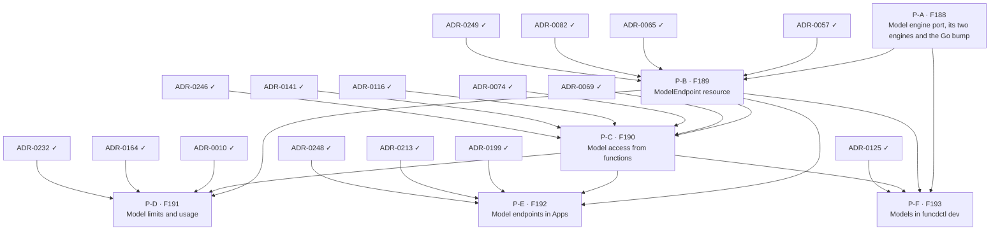

# AI gateway delivery plan — ADR sequencing to ship FEAT-0015

- **Status**: Active (living — update as ADRs are created, accepted and implemented)
- **Date**: 2026-10-24
- **Realizes**: [FEAT-0015 (AI gateway)](../feat/0015-feat-ai-gateway.md)
- **Process**: [ADR-0000](../adr/0000-adr-process.md) · skills `/adr` → `/adr-judge` → `/adr-impl` → `/adr-impl-review`

## Purpose & how to read this

This file sequences the ADRs that realize FEAT-0015's six built features (F188 to F193, no gaps) so that the epoch
becomes implementable without dead-ends or stalls. F194 and F195 are ideas and get no item. It is a *plan*, not a
decision: it commits to no architecture, which is the ADRs' job. The slate comes from the
[design report](../reports/ai-gateway-design.md), whose decisions and open questions each ADR takes up.

**Two tracks.** The *design track* creates, judges and accepts ADRs, and is serialized by review bandwidth. The *build
track* implements and reviews them, and is serialized by hard compile and runtime dependencies. Keep the design track
one wave ahead of the build track.

> **ADR numbers here are placeholders** (`P-A …`). `/adr` assigns the real number at creation. Track the work by
> **feature code** (stable).

## Proposed ADR slate

| Plan id | Proposed ADR working title | Realizes | Build-depends on |
|---|---|---|---|
| P-A | Model engine port, its two engines and the Go bump: the Go port the facade calls, capabilities and settings schemas, the engine built on Bifrost's Go library and the engine in the daemon, one conformance suite, Go 1.27.3 and the review of Bifrost's modules | F188 | — |
| P-B | ModelEndpoint resource: the kind and its models, the key the daemon reads from a Secret, readiness, the provider catalog row, delete protection, the rule for an endpoint's address | F189 | P-A, ADR-0057, ADR-0065, ADR-0082, ADR-0249 |
| P-C | Model access from functions: the binding, the local API routes and streaming, the facade and its checks, Cedar, the TypeScript and Python helpers, Workflow steps | F190 | P-B, ADR-0069, ADR-0074, ADR-0116, ADR-0141, ADR-0246 |
| P-D | Model limits and usage: caps per endpoint and per binding, the counters, the usage ledger in rqlite, telemetry and audit records | F191 | P-B, P-C, ADR-0010, ADR-0164, ADR-0232 |
| P-E | Model endpoints in Apps: the App's endpoint entry and its declared Secret | F192 | P-B, P-C, ADR-0199, ADR-0213, ADR-0248 |
| P-F | Models in funcdctl dev: the engine in the daemon or a real endpoint in the dev loop | F193 | P-A, P-B, P-C, ADR-0125 |

## Build dependency graph

The slate table is authoritative; this graph is generated from it (`ai-gateway-plan.json`, `plan_waves.py`).

## Build waves (computed)

| Tier | Items |
|---|---|
| 0 (done) | ADR-0010, ADR-0057, ADR-0065, ADR-0069, ADR-0074, ADR-0082, ADR-0116, ADR-0125, ADR-0141, ADR-0164, ADR-0199, ADR-0213, ADR-0232, ADR-0246, ADR-0248, ADR-0249 |
| 1 | P-A |
| 2 | P-B |
| 3 | P-C |
| 4 | P-D, P-E, P-F |

- **Wave 1, P-A**: the port and both engines are plain Go, and the Go bump lands with them; everything after calls
  models through the port.
- **Wave 2, P-B**: the endpoint kind needs the port to check an endpoint and to hand its key to the engine.
- **Wave 3, P-C**: access needs an endpoint to bind and the port to call.
- **Wave 4, P-D, P-E and P-F**: limits, Apps and the dev loop each need the access path that functions use, not each
  other.

### Cross-cutting sequencing notes

- P-A's conformance suite is the test harness for every later engine: the engine in the daemon lands with it, so P-C's
  checks and P-F's dev loop run with no network and no bill from their first commit.
- P-A moves funcd to Go 1.27.3 in `go.mod` and the flake's pin, because Bifrost's `core` module requires it; every
  later item builds on that toolchain.
- P-B's delete protection checks the bindings that P-C adds. For SQL, the delete-while-bound rule landed with access
  ([ADR-0233](../adr/0233-sql-access-from-functions.md), F129), not with the database kind (ADR-0232, F128); the same
  split is open to P-B and P-C.
- P-C changes both shims, which ship as releases of funcd-typescript and funcd-python before funcd takes them
  ([ADR-0141](../adr/0141-repo-split-pyvvo-pinned-language-modules.md)).
- P-D chooses the ledger's database. If it is a SQLDatabase, the ledger runs on an rqlite engine that starts after the
  daemon (ADR-0232), which is why P-D decides what a call does before the ledger is up.

## Design track — what to create + accept ahead

- **Now**: draft, judge and accept P-A. It decides the port, the capability names, the Go bump and the module review,
  whether one Bifrost client serves the daemon, and how a panic on Bifrost's goroutines is kept from stopping it.
- **With P-A's build**: draft P-B. It carries the open questions on the kind's name, readiness and who may set an
  endpoint's address, so brief it with the decider first.
- **With P-B's build**: draft P-C. P-C is the riskiest ADR of the epoch: the public `ctx.ai` API and the stream over
  the function's socket are hard to change once functions use them.
- **With P-C's build**: draft P-D, P-E and P-F. P-D carries the questions on token caps, abandoned streams and the
  ledger at start, so brief it with the decider first.

## Critical path & the exit-criterion spine

Computed critical path: **ADR-0057 → P-B → P-C → P-D** (P-A sits before P-B in the same chain length).

| Exit-criterion clause | Needs (items) |
|---|---|
| An App declares a model endpoint whose key is a declared Secret | P-B, P-E |
| Its functions chat with a bound model, whole and streamed, and embed text, from both runtimes | P-C |
| No key and no vendor SDK in their sandbox | P-B, P-C |
| A call is refused without reaching the vendor once its cap is spent | P-D |
| Each call's usage is recorded against its function | P-D |
| `funcdctl dev` runs one of its functions with no network | P-A, P-F |
| The engine built on Bifrost's Go library and the engine in the daemon pass the same conformance suite | P-A |
| An endpoint reports Ready when its key resolves, and a delete is refused while a function binds it | P-B, P-C |

The exit criterion is met at wave 4, when P-D, P-E and P-F land.

## Parallelization & sequencing notes

- P-E and P-F are leaves: nothing depends on them, and they can trail the critical path. P-D is the terminal sink, so
  the limits are not deferrable.
- P-C deserves the most design and review time (above).
- P-A's capability names bind every later engine, including F195's if it is ever built.

## Caveats (living doc)

- Real ADR numbers are assigned by `/adr` at creation; reconcile placeholders as ADRs land.
- Waves are dependency tiers, not a schedule — within a wave, sequence by review bandwidth.
- If a drafted ADR reveals a missed dependency, update `ai-gateway-plan.json` and re-run the tool; re-validate the
  graph. (The accepted ADR still wins for architecture; this plan only tracks ordering.)
