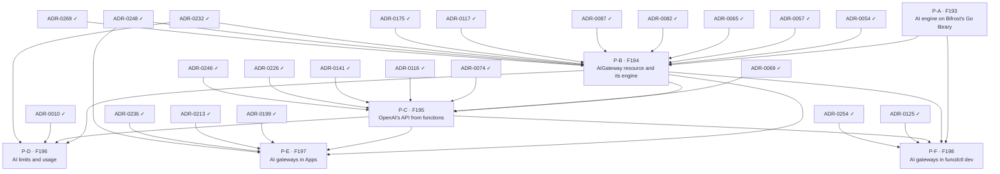

# AI gateway delivery plan — ADR sequencing to ship FEAT-0015

- **Status**: Active (living — update as ADRs are created, accepted and implemented)
- **Date**: 2026-10-24
- **Realizes**: [FEAT-0015 (AI gateway)](../feat/0015-feat-ai-gateway.md)
- **Process**: [ADR-0000](../adr/0000-adr-process.md) · skills `/adr` → `/adr-judge` → `/adr-impl` → `/adr-impl-review`

## Purpose & how to read this

This file sequences the ADRs that realize FEAT-0015's six built features (F193 to F198, no gaps) so that the epoch
becomes implementable without dead-ends or stalls. F199 is an idea and gets no item. It is a *plan*, not a decision:
it commits to no architecture, which is the ADRs' job. The slate comes from the
[design report](../reports/ai-gateway-design.md), whose decisions and open questions each ADR takes up.

**Two tracks.** The *design track* creates, judges and accepts ADRs, and is serialized by review bandwidth. The *build
track* implements and reviews them, and is serialized by hard compile and runtime dependencies. Keep the design track
one wave ahead of the build track.

> **ADR numbers here are placeholders** (`P-A …`). `/adr` assigns the real number at creation. Track the work by
> **feature code** (stable).

## Proposed ADR slate

| Plan id | Proposed ADR working title | Realizes | Build-depends on |
|---|---|---|---|
| P-A | AI engine on Bifrost's Go library: the nested module `engines/ai/`, the OpenAI-compatible handler on Bifrost's core converters, the settings Bifrost takes, the conformance suite against a local OpenAI-compatible server, the review of Bifrost's modules | F193 | — |
| P-B | AIGateway resource and its engine: the kind and its models, the engine image, one engine per gateway through the add-on runtime, the keys in its environment, the root `sql` entry, readiness, the egress grant for its models' hosts, the provider catalog row, delete protection | F194 | P-A, ADR-0054, ADR-0057, ADR-0065, ADR-0082, ADR-0087, ADR-0117, ADR-0175, ADR-0232, ADR-0248, ADR-0269 |
| P-C | OpenAI's API from functions: the binding, the local API route and streaming, the facade's alias, Cedar and defaults, the errors, the TypeScript and Python helpers, Workflow steps | F195 | P-B, ADR-0069, ADR-0074, ADR-0116, ADR-0141, ADR-0226, ADR-0246 |
| P-D | AI limits and usage: caps per gateway and per binding, the usage rows in the gateway's database, the counters rebuilt from them, abandoned streams, telemetry and audit records | F196 | P-B, P-C, ADR-0010, ADR-0232 |
| P-E | AI gateways in Apps: the App's gateway entry, its declared Secrets and the App's database | F197 | P-B, P-C, ADR-0199, ADR-0213, ADR-0236, ADR-0248 |
| P-F | AI gateways in funcdctl dev: the real engine as a host process, with the developer's keys | F198 | P-A, P-B, P-C, ADR-0125, ADR-0254 |

## Build dependency graph

The slate table is authoritative; this graph is generated from it (`ai-gateway-plan.json`, `plan_waves.py`).

## Build waves (computed)

| Tier | Items |
|---|---|
| 0 (done) | ADR-0010, ADR-0054, ADR-0057, ADR-0065, ADR-0069, ADR-0074, ADR-0082, ADR-0087, ADR-0116, ADR-0117, ADR-0125, ADR-0141, ADR-0175, ADR-0199, ADR-0213, ADR-0226, ADR-0232, ADR-0236, ADR-0246, ADR-0248, ADR-0254, ADR-0269 |
| 1 | P-A |
| 2 | P-B |
| 3 | P-C |
| 4 | P-D, P-E, P-F |

- **Wave 1, P-A**: the engine is plain Go in its own module, testable against a local OpenAI-compatible server before
  any resource runs it.
- **Wave 2, P-B**: the gateway kind runs the engine through the add-on runtime and needs the engine to check readiness.
- **Wave 3, P-C**: access needs a gateway to bind and its engine to call.
- **Wave 4, P-D, P-E and P-F**: limits, Apps and the dev loop each need the access path that functions use, not each
  other.

### Cross-cutting sequencing notes

- P-A's conformance suite is the test harness for the engine: there is no fake engine, so every later item tests
  against the real engine and a local OpenAI-compatible server.
- P-A's module requires Go 1.27.3, as Bifrost's `core` does; the daemon's `go.mod` and Go version do not change.
- P-B adds funcd's first engine built from its own source: today's engine images build other projects' pinned code
  (`images/runtime/rqlite/Dockerfile`). Moving those images and their build scripts into `engines/` is a separate
  refactor ADR, after this epoch.
- P-B's egress grant extends the egress gateway's worker index and its compiled permits, which today know only Function
  and Lake workers ([ADR-0175](../adr/0175-engine-is-its-own-principal.md)).
- P-B's delete protection checks the bindings that P-C adds. For SQL, the delete-while-bound rule landed with access
  ([ADR-0233](../adr/0233-sql-access-from-functions.md), F129), not with the database kind (ADR-0232, F128); the same
  split is open to P-B and P-C.
- P-C changes both shims, which ship as releases of funcd-typescript and funcd-python before funcd takes them
  ([ADR-0141](../adr/0141-repo-split-pyvvo-pinned-language-modules.md)). It also adds the first Cedar policy that reads
  the request context.

## Design track — what to create + accept ahead

- **Now**: draft, judge and accept P-A. It decides the engine's module and its OpenAI handler, reviews the licenses of
  Bifrost's dependencies, and measures an idle engine's memory with an experiment, which sets the engine's default
  memory limit.
- **With P-A's build**: draft P-B. It carries the egress grant and the engine image.
- **With P-B's build**: draft P-C. P-C is the riskiest ADR of the epoch: the route, the streaming, the errors and the
  helpers are hard to change once functions use them.
- **With P-C's build**: draft P-D, P-E and P-F.

## Critical path & the exit-criterion spine

Computed critical path: **ADR-0054 → P-B → P-C → P-D** (P-A sits before P-B in the same chain length).

| Exit-criterion clause | Needs (items) |
|---|---|
| An App declares an AIGateway whose keys are declared Secrets | P-B, P-E |
| Its functions chat, whole and streamed, and embed through an OpenAI client from both runtimes | P-C |
| No key in their sandbox | P-B, P-C |
| A call is refused without reaching the engine once its cap is spent | P-D |
| Each call's usage is recorded against its function | P-D |
| `funcdctl dev` runs one of its functions against the real engine | P-F |
| The engine passes the conformance suite, and a panic in it ends that engine only | P-A |
| Applying a gateway starts its engine, which reports Ready when its keys resolve; with egress control on, the engine reaches only its models' hosts | P-B |
| A delete is refused while a function binds the gateway | P-B, P-C |

The exit criterion is met at wave 4, when P-D, P-E and P-F land.

## Parallelization & sequencing notes

- P-E and P-F are leaves: nothing depends on them, and they can trail the critical path. P-D is the terminal sink, so
  the limits are not deferrable.
- P-C deserves the most design and review time (above).

## Caveats (living doc)

- Real ADR numbers are assigned by `/adr` at creation; reconcile placeholders as ADRs land. The first one is ADR-0280
  or later: ADR-0278 and ADR-0279 are claimed on another branch.
- Waves are dependency tiers, not a schedule — within a wave, sequence by review bandwidth.
- If a drafted ADR reveals a missed dependency, update `ai-gateway-plan.json` and re-run the tool; re-validate the
  graph. (The accepted ADR still wins for architecture; this plan only tracks ordering.)
