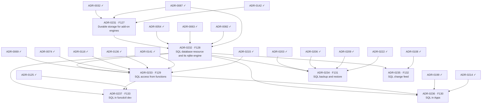

# SQL delivery plan — ADR sequencing to ship FEAT-0011

- **Status**: Active (living — update as ADRs are created/accepted/implemented)
- **Date**: 2026-10-12
- **Realizes**: [FEAT-0011 (SQL databases)](../feat/0011-feat-sql.md)
- **Process**: [ADR-0000](../adr/0000-adr-process.md) · skills `/adr` → `/adr-judge` → `/adr-impl` → `/adr-impl-review`

## Purpose & how to read this

This file sequences the ADRs that realize FEAT-0011's seven planned features (F127 to F133, no gaps) so that the epoch
becomes implementable without dead-ends or stalls. F134 and F135 are ideas and get no item. It is a *plan*, not a
decision: it commits to no architecture, which is the ADRs' job. The slate comes from the
[design report](../reports/sql-provider-design.md), whose decisions and open questions each ADR takes up.
[dr-delivery-plan.md](dr-delivery-plan.md) covers FEAT-0009; this plan is separate because FEAT-0011 is a later epoch.

**Two tracks.** The *design track* creates, judges and accepts ADRs, and is serialized by review bandwidth. The *build
track* implements and reviews them, and is serialized by hard compile and runtime dependencies. Keep the design track
one wave ahead of the build track.

> **ADR numbers.** The seven ADRs of this plan are ADR-0231 to ADR-0237, all Accepted on 2026-10-12; their `ADR-0231` to
> `ADR-0237` placeholders are reconciled below. Track the work by **feature code** (stable).

## Proposed ADR slate

| Plan id | Proposed ADR working title | Realizes | Build-depends on |
|---|---|---|---|
| ADR-0231 | Durable storage for add-on engines: a directory the platform owns per engine, mounted into it, kept across restarts and re-creations, reclaimed on delete | F127 | ADR-0032, ADR-0087, ADR-0142 |
| ADR-0232 | SQL database resource and its rqlite engine: the kind, the reconciler, the engine image, its bounds, readiness and delete protection | F128 | ADR-0231, ADR-0054, ADR-0063, ADR-0082, ADR-0087 |
| ADR-0233 | SQL access from functions: the binding, the local API routes, the PEP, the Cedar capability, the roles, the shim helpers and Workflow step bindings | F129 | ADR-0232, ADR-0069, ADR-0074, ADR-0116, ADR-0136, ADR-0141, ADR-0215 |
| ADR-0236 | SQL in Apps: the App section with its deletion policy, and migrations in hooks | F130 | ADR-0232, ADR-0233, ADR-0199, ADR-0214 |
| ADR-0234 | SQL backup and restore: the workload member, its copy and its load | F131 | ADR-0232, ADR-0203, ADR-0206, ADR-0209, ADR-0222 |
| ADR-0235 | SQL change feed: row changes as named events | F132 | ADR-0232, ADR-0108 |
| ADR-0237 | SQL in funcdctl dev: the engine as a local process | F133 | ADR-0232, ADR-0233, ADR-0125 |

Two merges are deliberate. ADR-0232 joins the kind, its engine image and its lifecycle, since an engine is never deployed
without its resource. ADR-0233 joins the binding, the PEP, Cedar, the roles and the shim helpers, since they form one access
contract. Split either one if its ADR passes 250 lines; the engine image and the shim helpers are the natural cuts.

Each dependency is grounded in one line:

- ADR-0231 extends the add-on runtime's `ProviderSpec` and `Converge` (ADR-0087), maps the directory onto the container
  port's `Mounts` (ADR-0032), and keeps the data across the re-creations that supervision makes (ADR-0142).
- ADR-0232 deploys its engine through the add-on runtime (ADR-0087) with the storage of ADR-0231, embeds its image like the other
  curated images (ADR-0054), adds a row to the provider catalog (ADR-0082) and protects deletes in the admission chain
  (ADR-0063).
- ADR-0233 serves the binding on the worker-node local API (ADR-0069), authorizes through Cedar (ADR-0074) with a capability
  on the registry (ADR-0116), adds roles (ADR-0136), ships the helpers through the pinned language modules
  (ADR-0141) and joins the dependency check (ADR-0215); it binds the databases of ADR-0232.
- ADR-0236 adds a section to the App (ADR-0199) and runs migrations from its hooks (ADR-0214), which call SQL through ADR-0233.
- ADR-0234 adds a member to the workload backups (ADR-0222) on the common format (ADR-0203, ADR-0209) and restores under the
  hold (ADR-0206); it copies the engines of ADR-0232.
- ADR-0235 publishes named events (ADR-0108) from the engines of ADR-0232.
- ADR-0237 runs ADR-0232's engine as a process under `funcdctl dev` (ADR-0125), for functions that call it through ADR-0233.

## Build dependency graph

The slate table is authoritative; this graph is generated from it.



## Build waves (computed)

| Tier | Items |
|---|---|
| 0 (done) | ADR-0032, ADR-0054, ADR-0063, ADR-0069, ADR-0074, ADR-0082, ADR-0087, ADR-0108, ADR-0116, ADR-0125, ADR-0136, ADR-0141, ADR-0142, ADR-0199, ADR-0203, ADR-0206, ADR-0209, ADR-0214, ADR-0215, ADR-0222 |
| 1 | ADR-0231 |
| 2 | ADR-0232 |
| 3 | ADR-0233, ADR-0234, ADR-0235 |
| 4 | ADR-0236, ADR-0237 |

Why each tier:

- **Tier 1**: ADR-0231 needs only built ADRs. It is the keystone: no SQL engine keeps its data without it.
- **Tier 2**: ADR-0232 needs the storage of ADR-0231.
- **Tier 3**: ADR-0233, ADR-0234 and ADR-0235 each need only the databases of ADR-0232, so they build in parallel.
- **Tier 4**: ADR-0236 and ADR-0237 need both the databases of ADR-0232 and the function access of ADR-0233.

### Cross-cutting sequencing notes

- **The test harness.** The in-process platform (`funcd.InMemory()`) runs no containers, so a SQL engine never starts
  there, as the catalog engine never reaches Ready in-process. Either ADR-0232 ships a process-mode engine driver for its
  tests, which ADR-0237 then embeds for `funcdctl dev`, or ADR-0232 and ADR-0233 prove themselves on the Lima lanes. The ADR-0232 ADR
  decides; the first option moves part of ADR-0237 earlier without changing the tiers.
- **The language repos.** ADR-0233's helpers ship in funcd-typescript and funcd-python as a release each, then `go get`
  here (ADR-0141); funcd's e2e can call the helper only after that bump.
- **The engine image in the lanes.** ADR-0232's image joins `just build-runtime-images`, so every lane that embeds the
  images builds it; colima must be running (see the known pitfalls in `.claude/CLAUDE.md`).
- **The hold.** The reclaim of a deleted database's directory and the delivery of change events respect the platform
  hold (ADR-0206), as the KV reclaim and eventing do.
- **App-scope backups.** Whichever of ADR-0236 and ADR-0234 lands second teaches `workload.Resolve` to list an App's databases,
  so an App's existing `backupSchedules` entry covers them.
- **Supervision.** ADR-0142 rule 9 already names a future rqlite provider: ADR-0232's reconciler requeues within the
  supervision period, and its steady pass writes nothing.

## Design track — what to create + accept ahead

- **Design wave 1**: draft ADR-0231 and ADR-0232 together. ADR-0232's image choice, a static build from source or the glibc build on
  a distroless base, can be proven while ADR-0231 is judged.
- **Design wave 2** (while ADR-0231 and ADR-0232 are built): draft ADR-0233, then ADR-0234 and ADR-0235.
- **Design wave 3**: draft ADR-0236 and ADR-0237.
- **Review attention.** ADR-0233 carries the authorization surface: the PEP, the built-in policies, the roles and the helper
  contract in two repos. ADR-0231 changes the add-on runtime and reclaims data on delete, so a wrong reclaim loses data. ADR-0235
  receives rqlite's at-least-once delivery and must drop duplicates. ADR-0232 fixes the image build and the bounds.

## Critical path & the exit-criterion spine

Critical path (5 items, the longest build chain):

  ADR-0032 → ADR-0231 → ADR-0232 → ADR-0233 → ADR-0236

| Exit-criterion clause (FEAT-0011) | Needs (items) |
|---|---|
| An App declares a SQL database | ADR-0236 (with ADR-0232) |
| Its functions read and write it from both runtimes with no credential in their sandbox | ADR-0233 |
| Its migrations run in a hook | ADR-0236 (with ADR-0233) |
| The data survives an engine restart and a daemon restart | ADR-0231, ADR-0232 |
| A backup restores it into a new name | ADR-0234 |
| A row change starts a Sensor's action | ADR-0235 |
| `funcdctl dev` runs one of its functions with its database | ADR-0237 |
| F127: an engine's data survives its crash, its re-creation and a daemon restart; deleting the owner reclaims the directory | ADR-0231 |
| F128: a database starts its engine and reports Ready; one engine per database; a delete is refused while bound or holding data; the bounds hold | ADR-0232 |
| F129: reads by binding, writes by grant or role, an unbound function refused, no path around funcd, builder SQL runs as it is, atomic batches, both runtimes | ADR-0233 |
| F130: the migration hook creates the schema before the new revision serves; an upgrade applies only new migrations; the deletion policy | ADR-0236 |
| F131: a scheduled, encrypted backup; a restore into a new name; the in-place restore rules | ADR-0234 |
| F132: an insert, an update and a delete start the action, also after an engine restart; a duplicate starts it once | ADR-0235 |
| F133: `funcdctl dev` runs a function that binds a database, its migrations and its queries | ADR-0237 |

Every clause has an item. The exit criterion is met at tier 4, when ADR-0236 and ADR-0237 land; ADR-0234 and ADR-0235 land in tier 3.

## Parallelization & sequencing notes

- **Leaves:** ADR-0234, ADR-0235 and ADR-0237: nothing depends on them and they are off the critical path, so they have slack; the
  exit criterion still needs all three.
- **Parallel inside tiers:** ADR-0233, ADR-0234 and ADR-0235 in tier 3; ADR-0236 and ADR-0237 in tier 4.
- **Riskiest ADRs:** ADR-0233 (the authorization surface), ADR-0231 (data reclaim) and ADR-0235 (duplicate delivery).
- **Not planned:** F134 (external access) and F135 (a shared server) are ideas; they get items only if the decider
  scopes them.

## Reproducing & maintaining this plan

```bash
python3 .claude/skills/roadmap-planner/scripts/plan_waves.py docs/roadmap/sql-plan.json
python3 .claude/skills/roadmap-planner/scripts/plan_waves.py docs/roadmap/sql-plan.json --check-waves
```

When an ADR reaches `Implemented`, move it from `items` to `accepted` in `sql-plan.json` and re-run. When an ADR is
drafted, note its number against its plan id in the caveats below.

## Caveats (living doc)

- `P-A` to `P-G` were reconciled on 2026-10-12: P-A ADR-0231, P-B ADR-0232, P-C ADR-0233, P-D ADR-0236, P-E
  ADR-0234, P-F ADR-0235, P-G ADR-0237.
- Waves are dependency tiers, not a schedule. Within a wave, sequence by review bandwidth.
- If a drafted ADR reveals a missed dependency, update `sql-plan.json` and re-run the tool; re-validate the graph. The
  accepted ADR still wins for architecture; this plan only tracks ordering.
- The open questions of FEAT-0011 are decided inside these ADRs; none needs an item of its own.
