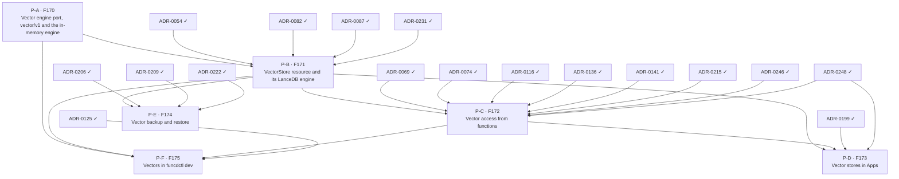

# Vector delivery plan — ADR sequencing to ship FEAT-0013

- **Status**: Active (living — update as ADRs are created, accepted and implemented)
- **Date**: 2026-10-22
- **Realizes**: [FEAT-0013 (vector stores)](../feat/0013-feat-vector.md)
- **Process**: [ADR-0000](../adr/0000-adr-process.md) · skills `/adr` → `/adr-judge` → `/adr-impl` → `/adr-impl-review`

## Purpose & how to read this

This file sequences the ADRs that realize FEAT-0013's six built features (F170 to F175, no gaps) so that the epoch
becomes implementable without dead-ends or stalls. F176 to F179 are ideas and get no item. It is a *plan*, not a
decision: it commits to no architecture, which is the ADRs' job. The slate comes from the
[design report](../reports/vector-store-design.md), whose decisions and open questions each ADR takes up.

**Two tracks.** The *design track* creates, judges and accepts ADRs, and is serialized by review bandwidth. The *build
track* implements and reviews them, and is serialized by hard compile and runtime dependencies. Keep the design track
one wave ahead of the build track.

> **ADR numbers here are placeholders** (`P-A …`). `/adr` assigns the real number at creation. Track the work by
> **feature code** (stable).

## Proposed ADR slate

| Plan id | Proposed ADR working title | Realizes | Build-depends on |
|---|---|---|---|
| P-A | Vector engine port, `vector/v1` and the in-memory engine: the Go port the facade calls, the protocol to engine containers, capabilities and params schemas, exact search in memory, one conformance suite | F170 | — |
| P-B | VectorStore resource and its LanceDB engine: the kind, its tables and fields, the reconciler, the engine image and its directory, readiness, bounds, delete protection, the default engine | F171 | P-A, ADR-0054, ADR-0082, ADR-0087, ADR-0231 |
| P-C | Vector access from functions: the binding, the local API, the facade and its checks, the portable filter, Cedar and roles, the TypeScript and Python helpers, Workflow steps | F172 | P-B, ADR-0069, ADR-0074, ADR-0116, ADR-0136, ADR-0141, ADR-0215, ADR-0246, ADR-0248 |
| P-D | Vector stores in Apps: the App's store entry and its deletion policy | F173 | P-B, P-C, ADR-0199, ADR-0248 |
| P-E | Vector backup and restore: a store as a workload backup member | F174 | P-B, ADR-0206, ADR-0209, ADR-0222 |
| P-F | Vectors in funcdctl dev: a store in the dev loop | F175 | P-A, P-B, P-C, ADR-0125 |

## Build dependency graph

The slate table is authoritative; this graph is generated from it (`vector-plan.json`, `plan_waves.py`).

## Build waves (computed)

| Tier | Items |
|---|---|
| 0 (done) | ADR-0054, ADR-0069, ADR-0074, ADR-0082, ADR-0087, ADR-0116, ADR-0125, ADR-0136, ADR-0141, ADR-0199, ADR-0206, ADR-0209, ADR-0215, ADR-0222, ADR-0231, ADR-0246, ADR-0248 |
| 1 | P-A |
| 2 | P-B |
| 3 | P-C, P-E |
| 4 | P-D, P-F |

- **Wave 1, P-A**: the port and the in-memory engine are plain Go; everything after calls engines through them.
- **Wave 2, P-B**: the store kind needs the port, the add-on runtime and an engine's durable directory.
- **Wave 3, P-C and P-E**: access and backup each need a running store, not each other.
- **Wave 4, P-D and P-F**: an App's store and the dev loop need the access path that functions use.

### Cross-cutting sequencing notes

- P-A's conformance suite is the test harness for every later engine: it lands with the in-memory engine, so P-B's
  LanceDB engine is checked against it from its first commit.
- P-C changes both shims, which ship as releases of funcd-typescript and funcd-python before funcd takes them
  ([ADR-0141](../adr/0141-repo-split-pyvvo-pinned-language-modules.md)).
- The LanceDB engine image is new in P-B: its size decides whether it is embedded, as rqlite's, or pulled.

## Design track — what to create + accept ahead

- **Now**: draft, judge and accept P-A; it decides the port, the capability names and the in-memory engine.
- **With P-A's build**: draft P-B. It carries the decider's open question on how the image ships, so brief it first.
- **With P-B's build**: draft P-C and P-E. P-C is the riskiest ADR of the epoch: the public API, the filter and the
  grants are hard to change once functions use them.
- **With P-C's build**: draft P-D and P-F.

## Critical path & the exit-criterion spine

Computed critical path: **ADR-0054 → P-B → P-C → P-D** (P-A sits before P-B in the same chain length).

| Exit-criterion clause | Needs (items) |
|---|---|
| An App declares a vector store | P-B, P-D |
| Its functions upsert and search by vector, by text and both, with a filter, from both runtimes | P-C |
| No engine and no credential in the sandbox | P-C |
| The data survives an engine restart and a daemon restart | P-B |
| A backup restores it into a new name | P-E |
| `funcdctl dev` runs a function with its store | P-F |
| The LanceDB and in-memory engines pass the same conformance suite | P-A, P-B |

The exit criterion is met at wave 4, when P-D and P-F land; P-E can land in wave 3.

## Parallelization & sequencing notes

- P-E and P-F are leaves: nothing depends on them, and they can trail the critical path.
- P-C deserves the most design and review time (above).
- P-A's capability names bind every later engine, including the ones FEAT-0013 keeps as references.

## Caveats (living doc)

- Real ADR numbers are assigned by `/adr` at creation; reconcile placeholders as ADRs land.
- Waves are dependency tiers, not a schedule — within a wave, sequence by review bandwidth.
- If a drafted ADR reveals a missed dependency, update `vector-plan.json` and re-run the tool; re-validate the graph.
  (The accepted ADR still wins for architecture; this plan only tracks ordering.)
